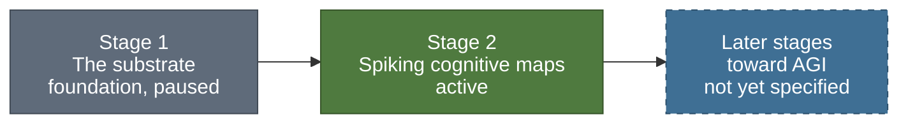
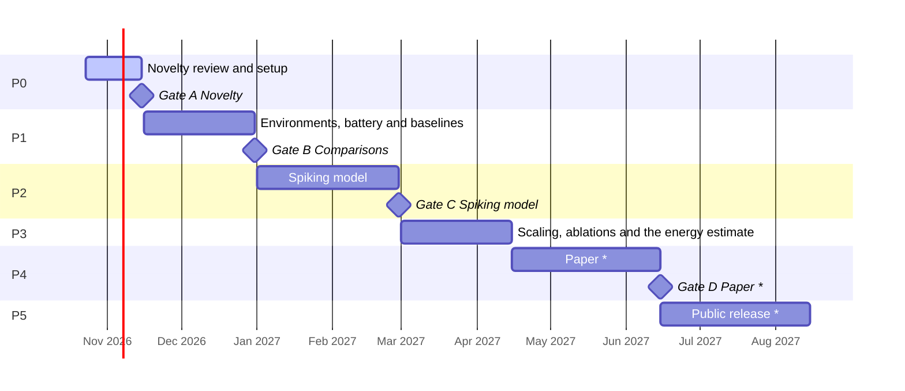
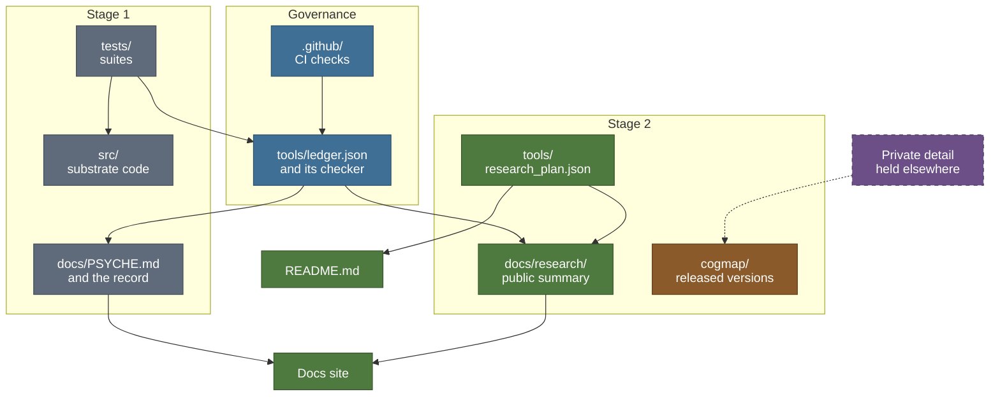

<h1>
  <picture>
    <source media="(prefers-color-scheme: dark)" srcset="brand/psyche-wordmark-dark.svg">
    
  </picture>
</h1>

[](https://github.com/cagancaliskan/psyche/actions/workflows/tests.yml)
[](https://github.com/cagancaliskan/psyche/actions/workflows/pages.yml)
[](https://doi.org/10.5281/zenodo.20474613)
[](LICENSE)

Psyche is an open research project that builds brain-inspired components in stages, each built
test-first and kept as a citable artifact, with artificial general intelligence (AGI) as its
long-term aim. AGI is named as an aim only: nothing built so far is general intelligence, and
these pages make no such claim. Stage 1, a dependency-free memory-and-activation substrate, is the
foundation, and its report is archived with a DOI. Stage 2, spiking cognitive maps, is a test of
whether a spiking network that learns only through local synaptic plasticity shows the behaviours
that an internal map would explain and memorised responses would not.

**Status.** The current phase and the next decision gate of stage 2, rendered from
[`tools/research_plan.json`](tools/research_plan.json); the [roadmap](#roadmap) below explains the
phases and gates:

<!-- generated:status-line:start -->
**Now:** P0 Novelty review and setup (2026-10-23 to 2026-11-15) · **Next gate:** A Novelty, 2026-11-15
<!-- generated:status-line:end -->

No stage 2 results are reported yet. Its pages describe a plan and put questions, not answers.

- **Read:** the documentation site, <https://cagancaliskan.github.io/psyche/>, or the
  [Reader's guide](docs/guide.md) for a first pass; [MOC.md](MOC.md) is the map of content, and
  [how the project is run](docs/governance.md) and the
  [engineering standards](docs/research/engineering.md) say how the work is kept honest.
- **Run:** the [Quick start](#quick-start) below runs the substrate's suites and the commit gate on
  your machine.
- **Cite:** see [Citation](#citation) below and [`CITATION.cff`](CITATION.cff).
- **Get in touch:** [GitHub Discussions](https://github.com/cagancaliskan/psyche/discussions) for
  questions and ideas; the
  [bug report form](https://github.com/cagancaliskan/psyche/issues/new/choose) for a wrong claim,
  a stale number or a broken link; [SECURITY.md](SECURITY.md) for a vulnerability, which is
  reported privately. Contributors start at [CONTRIBUTING.md](CONTRIBUTING.md).

## Quick start

**What you need**

- A `python3` on your PATH that is CPython 3.10 to 3.14, the range CI covers. `make` runs
  `python3`, so the name matters. Nothing needs `pip install`: the substrate, its suites and the
  tools use the standard library only. Python 3.9, which `/usr/bin/python3` can be on macOS, is
  too old: a test fixture holds 3.10 syntax, so `tools/test_ledger.py` and one of the substrate's
  suites stop with a `SyntaxError`. If your `python3` is older, make a newer interpreter come first
  on your PATH under that name; `make setup` prints an example.
- `git`, and a full clone: some suites read earlier revisions with git, so on a shallow clone
  (`--depth 1`) or a downloaded archive both `make test` and `make check` fail.
- Every minor from 3.10 to 3.14 on your PATH as `python3.10` to `python3.14`, for `make test` to
  exit 0. Some suites compare results across the interpreters they find under those names; with
  fewer, they report failures on a correct tree or stop with an error. `make check` needs only the
  one `python3`. `make setup` installs them with [uv](https://docs.astral.sh/uv/), which is
  optional: any other way of putting them on your PATH works.
- Optional: GNU make (without it, on Windows for example, run the plain command beside each
  target), and Node.js 22.23.4 or newer with npm (CI uses the version in `website/.nvmrc`), which
  only the docs site needs.

**Run it**

```bash
git clone https://github.com/cagancaliskan/psyche.git
cd psyche
make          # lists the targets
make setup    # only if python3.10 to python3.14 are not all on your PATH yet; needs uv
make test     # the substrate's suites
make check    # the commit gate, the plan and diagram checks and the tool suites
```

`make test` exits 0 only when every minor from 3.10 to 3.14 is on your PATH as `python3.X`: with
fewer it reports failures on a correct tree, so run `make setup` first unless you already have
them. `make check` needs only the one `python3` and a full clone, and takes longer on Python 3.10
than on newer versions, up to a few minutes. The plain command behind each target:

| Target | What it does | Plain command |
|---|---|---|
| `make test` | Runs every registered suite of the substrate | `python3 run_tests.py` |
| `make check` | Runs the checks listed after this table | the commands below |
| `make setup` | Optional: downloads the interpreters CI uses, with uv (no sudo, no change to your shell profile), then reports which `python3.X` your PATH finds and whether `python3` is recent enough; without uv it prints how to install it and stops | `uv python install 3.10 3.11 3.12 3.13 3.14`, then put the directory that `uv python dir --bin` prints on your PATH; or `bash tools/setup_python.sh`, which needs bash and not make |
| `make site` | Serves the docs site on your machine; open the address it prints, which ends in `/psyche/` | `cd website`, `npm ci`, then `npm run dev` |
| `make capture` | Maintainers only, see [Running the tests](#running-the-tests) | `python3 tools/capture_run.py` |

`make check` runs these, and stops at the first one that fails:

```bash
python3 tools/ledger_check.py --only C1,C3,C4,C5,C6
python3 tools/publish/ci_c2.py
python3 tools/publish/check_copy.py
python3 tools/publish/render_plan.py --check
python3 tools/publish/diagrams.py --check
python3 tools/test_ledger.py
python3 -B tools/publish/test_core.py
python3 -B tools/publish/test_checks.py
```

The site stages its pages from the last commit, and refuses to stage while a page it publishes
differs from that commit: commit your edits to those pages before `make site`.

## The stages



Stage 1 produced the project's method, and its attempts at a cognitive claim taught the lesson
stage 2 is built around: a claim needs an external yardstick. Later stages build on the same
discipline and are not specified publicly yet. Which line is being worked on is `program` in
[`tools/ledger.json`](tools/ledger.json); the decisions behind this structure are D-031 and D-033
in [DECISIONS.md](DECISIONS.md).

## Stage 2: spiking cognitive maps

> **Cognitive Map Formation and Energy Efficiency in Spiking Neural Networks with Local
> Plasticity**

Classic animal experiments, from Tolman's mazes onward, describe behaviour such as learning a maze
without reward, taking a detour and finding a shortcut, and Tolman argued that an internal map
explains such behaviour better than memorised stimulus-response associations do. This line asks
whether a brain-inspired network of spiking neurons that learns only through local synaptic
plasticity shows, on classic cognitive-map tests, the behaviours that an internal map would explain
and memorised responses would not; whether other families of agents, given the same experience,
show them too; and what the behaviour costs, as an analytic estimate of synaptic operations.

Every agent, the spiking model and the baselines alike, gets the same pre-generated exploration
and is scored by the same battery; how each paradigm is operationalised for an agent, and its pass
criterion, are pre-registered privately. If the spiking model falls short, a documented account of
where and why is kept as a result. The line claims nothing about cognition beyond the measurable
class of behaviour the battery tests, nothing about how animals solve the task, and no priority;
energy enters only as an analytic estimate, never as a hardware reading. The overview is in
[docs/research/README.md](docs/research/README.md) and the claims discipline in
[docs/research/claims-and-scope.md](docs/research/claims-and-scope.md).

### Roadmap

The status line, this chart and the gate table are generated from
[`tools/research_plan.json`](tools/research_plan.json), the only source of the line's dates; no
date is typed by hand.

<!-- generated:plan-gantt:start -->

<!-- generated:plan-gantt:end -->

Items marked \* in the chart have no fixed date yet; they are drawn up to a horizon derived from the plan, not to a date.

The phase table, the layers and the paper submission deadline are on the
[roadmap](docs/research/roadmap.md).

### Decision gates

A gate is a fixed point where a decision is taken against criteria written in advance; the
question and the fallback are public, the criteria stay private until submission, and a decided
gate shows only the date it was decided and the next step. See
[Decision gates](docs/research/gates.md).

<!-- generated:gates-table:start -->
| Gate | Title | Date | Status | Question |
|---|---|---|---|---|
| A | Novelty | 2026-11-15 | upcoming | Is this line's combination of aims new, or is its difference from the closest published work written down and defensible? |
| B | Comparisons | 2026-12-31 | upcoming | Do the environments, the battery and the baseline agents run, and do the baselines reproduce the behaviour their papers report? |
| C | Spiking model | 2027-02-28 | upcoming | Does the spiking model meet its pre-registered behavioural criteria on the battery? |
| D | Paper | one week before the submission deadline | upcoming | Are all figures, the multi-seed results and the ablations in, and have external readers' comments been worked in? |
<!-- generated:gates-table:end -->

### Public and private

- **Public here:** the overview, roadmap, gates, test battery, claims discipline and engineering
  standards of this line, plus the substrate's full record.
- **Private until release:** hypotheses beyond the research questions, the criteria, the
  verdict, evidence and reasoning behind any decided gate, the experiment plan, the model, and
  the related-work analysis. They are developed privately.
- **Released later:** the line's code reaches [`cogmap/`](cogmap/README.md) only as older,
  complete, working versions, under the
  [disclosure policy](docs/research/disclosure-policy.md).

## Stage 1: the substrate

A dependency-free Python memory-and-activation substrate (a graph store, a spreading-activation
engine, an activation field, source clustering and a workspace).

**What is established.** The store and the activation layers are verified correct and
deterministic by the full adversarial suite on every interpreter; that is verification, not a
formal proof. The closed cycle is tester-verified as mechanism, and the experiment scaffolding is
exploratory. Every registered suite passes with zero failures on each CPython minor version and
hash seed in the sweep recorded in [`tools/ledger.json`](tools/ledger.json), which is also where
the counts live.

**What is not claimed.** Cognitive meaning for the closed cycle. Three attempts at a first
cognitive claim were each stopped before any graded number existed: semantic priming was circular,
the fan effect found the mechanism absent, and interoception found the signal flat. The finding is
scoped to this substrate and these three yardsticks ([The three walls](docs/three-walls.md)).

The full record is in [docs/PSYCHE.md](docs/PSYCHE.md), with its
[architecture](docs/ARCHITECTURE.md) and [methodology](docs/METHODOLOGY.md); the captured run is in
[docs/TEST_OUTPUT.txt](docs/TEST_OUTPUT.txt), and how the substrate led to stage 2 in
[docs/research/origins.md](docs/research/origins.md).

## Repository map



The plan renders the status, roadmap and gate blocks here and in `docs/research/`; the ledger's
checker holds the substrate record and the research pages to the ledger, and CI runs it on every
pull request and every push to main. `cogmap/` receives only released versions of the line's code
(the dashed arrow, under the disclosure policy).

| Path | Purpose | Stage | State |
|---|---|---|---|
| `src/` | The substrate's core modules, standard library only | 1 | paused |
| `tests/` | The substrate's builder suites and adversarial tester suites, kept passing | 1 | maintained |
| `experiments/` | The substrate's exploratory experiment scaffolding and its captured results | 1 | frozen |
| `docs/PSYCHE.md` | The substrate's record, formerly this README | 1 | maintained |
| `docs/` (substrate record) | Architecture, methodology, specs and the archived report; the paper draft is held (D-012) and kept outside this repository | 1 | maintained |
| `docs/research/` | The public summary of the cognitive-map line | 2 | active |
| `tools/research_plan.json` | The only source of the line's phases, gates and dates | 2 | active |
| `cogmap/` | Released versions of the spiking model, filled only by release | 2 | export-only |
| `tools/` | The ledger and its checker, the capture tools, the publishing tools, `setup_python.sh` | both | active |
| `Makefile` | The `make` targets of the quick start above | both | active |
| `website/` | The docs site, built from the pages listed in `docs/publish.json` | both | active |
| `.github/` | CI workflows that run the checks | both | active |

## Running the tests

The suites and the tools run on the Python standard library alone. They use a small built-in
harness and run as scripts, not under pytest: each prints `RESULT: N passed, M failed` and exits
non-zero on any failure.

- **`make test`** (`python3 run_tests.py`) runs every registered suite as its own process, with the
  right `PYTHONPATH` handled for you, and exits 0 only if every suite reported zero failures.
- **`make check`** is the commit gate plus the plan check, the diagram check and the tool suites.
  Its first command leaves C2, the check of prose against the ledger's counts, out while the paper
  is held (D-012, D-031); `ci_c2.py` runs it and tolerates findings only in the held paper.
- **`cogmap/`** is separate: it installs with its own pinned dependencies once a version is
  released, and `run_tests.py` never runs it.
- **`make capture`** (`python3 tools/capture_run.py`) is for maintainers. It runs the whole suite
  under every `python3.X` it finds and refuses to write anything if an interpreter fails, aborts a
  suite or disagrees with the others. Otherwise it rewrites
  [`docs/TEST_OUTPUT.txt`](docs/TEST_OUTPUT.txt), sets the swept interpreters and hash seeds in
  [`tools/ledger.json`](tools/ledger.json) and syncs the ledger's counts from the capture. It
  records the interpreters it found as the swept set, so run it with all of them on your PATH
  (`make setup`) and review the diff. `python3 tools/capture_run.py --dry-run` sweeps and writes
  nothing.

## Citation

The substrate's report is archived on **Zenodo**: **<https://doi.org/10.5281/zenodo.20474613>**.
Please cite:

> Caliskan, C. (2026). *Nous: Adversarial Testing of a Dependency-Free Memory-and-Activation
> Substrate for Cognitive Architectures.* Zenodo. https://doi.org/10.5281/zenodo.20474613

The archived title uses the project's earlier name (D-030). The **report is open access under
CC BY 4.0**; the **code is MIT-licensed** (see [LICENSE](LICENSE)). A machine-readable
[`CITATION.cff`](CITATION.cff) is provided at the repository root.

## License

MIT: see [LICENSE](LICENSE). Copyright (c) 2026 Cagan Caliskan.
