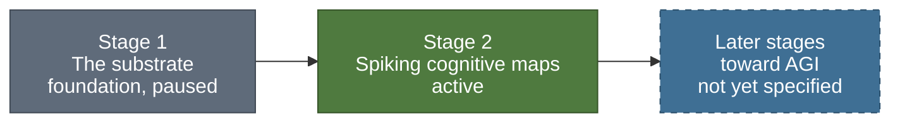
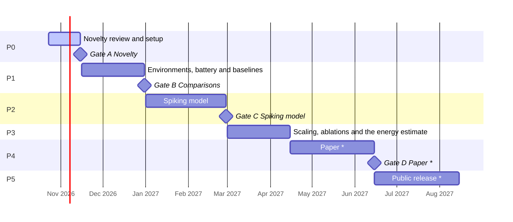
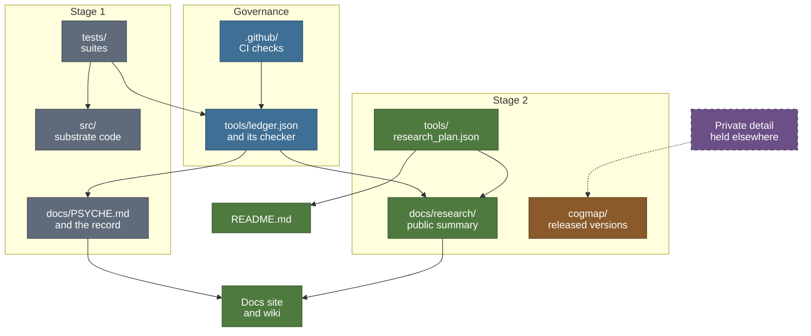

<h1>
  <picture>
    <source media="(prefers-color-scheme: dark)" srcset="brand/psyche-wordmark-dark.svg">
    
  </picture>
</h1>

> An open research project building toward artificial general intelligence (AGI) from original,
> brain-inspired components. It grows in stages; each stage is built test-first and kept as a
> citable artifact.

Psyche is designed and built by its author as one long-running project. AGI is its long-term
aim, stated as an aim: nothing built so far is general intelligence, and these pages make no such
claim. The project advances one stage at a time. Stage 1, a dependency-free memory-and-activation
substrate, is the foundation: it is archived with a DOI and it gave the project its method.
Stage 2, spiking cognitive maps, is the active line of research. Later stages are not yet
specified in public.

Documentation site: **<https://cagancaliskan.github.io/psyche/>** · Wiki:
**<https://github.com/cagancaliskan/psyche/wiki>**

---

## The stages



Each stage builds on the one before it:

1. **Stage 1, the substrate (foundation; development paused since 2026-10-23, D-031).** A
   dependency-free Python memory-and-activation substrate whose lower layers are proven correct
   and deterministic. It produced the project's method, and its attempts at a first cognitive
   claim taught the lesson stage 2 is built around: a claim needs an external yardstick.
   [Read more below](#stage-1-the-substrate).
2. **Stage 2, spiking cognitive maps (active since 2026-10-23).** A spiking network that learns
   only through local synaptic plasticity, evaluated on classic cognitive-map tests with published
   protocols, against baselines reproduced from their published behaviour.
   [Read more below](#stage-2-spiking-cognitive-maps).
3. **Later stages toward AGI.** They build on the same discipline and on the project's own
   designs. They are not specified publicly yet.

The decisions behind this structure are D-031 and D-033 in [DECISIONS.md](DECISIONS.md).

---

## Stage 2: spiking cognitive maps

> **Cognitive Map Formation and Energy Efficiency in Spiking Neural Networks with Local
> Plasticity**

### The line in one minute

Classic animal experiments, from Tolman's mazes onward, describe behaviour such as learning a
maze without reward, taking a detour and finding a shortcut. Tolman argued that an internal map
of the environment explains such behaviour better than memorised stimulus-response associations
do. This line of research asks three questions:

- Does a brain-inspired network of spiking neurons that learns only through local synaptic
  plasticity show, on classic cognitive-map tests, the behaviours that an internal map explains
  and memorised responses do not?
- Do other families of agents, given the same experience, show them too?
- What does the behaviour cost, as an analytic estimate of synaptic operations?

Every agent, the spiking model and the baseline agents alike, receives the same pre-generated
exploration of the same environments and is scored by the same test battery, built from classic
paradigms: latent learning, detour, shortcut, structural transfer and transitive inference. Each
agent is reported on three axes: behaviour on the battery, the structure of its internal
representations, and the estimated synaptic operations.

The plan does not rest on its riskiest part. The environments, the battery and the comparisons
form a safe base that stands on its own; if the spiking model falls short, a documented account
of where and why is kept as a result.

What it does not claim: nothing about cognition beyond the measurable class of behaviour the
battery tests, nothing about how animals solve the task, and no priority. Energy enters only as
an analytic estimate, never as a hardware reading. There are no results yet; these pages describe
a plan, and they state questions, not answers.

The full overview, with the research questions and the evaluation pipeline, is in
[docs/research/README.md](docs/research/README.md).

### Status

<!-- generated:status-line:start -->
**Now:** P0 Novelty review and setup (2026-10-23 to 2026-11-15) · **Next gate:** A Novelty, 2026-11-15
<!-- generated:status-line:end -->

The status line, the roadmap chart and the gate table in this section are generated from
[`tools/research_plan.json`](tools/research_plan.json), the only source of the line's dates. No
date is typed by hand.

### Roadmap

The work runs in phases, from a novelty review to a paper and a public release. Most phases close
at a decision gate.

<!-- generated:plan-gantt:start -->

<!-- generated:plan-gantt:end -->

Items marked \* in the chart have no fixed date yet; they are drawn up to a horizon derived from the plan, not to a date.

The phase table, the layers and the paper submission deadline are on the
[roadmap](docs/research/roadmap.md); each phase's outputs are listed in
[`tools/research_plan.json`](tools/research_plan.json).

### Decision gates

A gate is a fixed point in the plan where a decision is taken against criteria written in
advance. The question and the fallback are public; the criteria are written before the work
they judge and stay private until submission. Public status reads `upcoming` or `decided`,
without the verdict.

<!-- generated:gates-table:start -->
| Gate | Title | Date | Status | Question |
|---|---|---|---|---|
| A | Novelty | 2026-11-15 | upcoming | Is this line's combination of aims new, or is its difference from the closest published work written down and defensible? |
| B | Comparisons | 2026-12-31 | upcoming | Do the environments, the battery and the baseline agents run, and do the baselines reproduce the behaviour their papers report? |
| C | Spiking model | 2027-02-28 | upcoming | Does the spiking model meet its pre-registered behavioural criteria on the battery? |
| D | Paper | one week before the submission deadline | upcoming | Are all figures, the multi-seed results and the ablations in, and have external readers' comments been worked in? |
<!-- generated:gates-table:end -->

Each gate is described on [Decision gates](docs/research/gates.md).

### Public and private

- **Public here:** the overview, roadmap, gates, test battery, claims discipline and engineering
  standards of this line, plus the substrate's full record.
- **Private until release:** hypotheses beyond the research questions, the criteria, the
  experiment plan, the model, and the related-work analysis. They are developed privately.
- **Released later:** the line's code reaches [`cogmap/`](cogmap/README.md) only as older,
  complete, working versions, under the
  [disclosure policy](docs/research/disclosure-policy.md).

---

## Stage 1: the substrate

The substrate is a dependency-free Python prototype of a memory-and-activation substrate, and the
foundation of Psyche. A graph store of concept nodes and weighted roads feeds a deterministic
spreading-activation engine, a multi-source activation field and a source-clustering stage. A
workspace then runs one competition, prunes activated material that no perceived input supports,
and broadcasts back within a bounded budget, which biases the next cycle. The cycle closes end to
end: perceive, activate, cluster, compete, prune, broadcast.

Its aim, stated only as an aim and never as a property of the system, is a substrate that moves
information without loss and spends only the activation its inputs support, without producing
output its inputs do not support.

**What is established.** Its assurance comes in three tiers, kept strictly apart. The store and
the activation layers are proven correct and deterministic. The closed cycle is tester-verified
as mechanism. The experiment scaffolding is exploratory. Every registered suite passes with zero
failures on five CPython minor versions under six hash seeds; the counts live in
[`tools/ledger.json`](tools/ledger.json), and the captured run is
[docs/TEST_OUTPUT.txt](docs/TEST_OUTPUT.txt).

**What is not claimed.** No cognitive meaning is claimed for the closed cycle. Three attempts at a
first cognitive claim were each stopped before any graded number existed, each at a structurally
distinct wall: semantic priming was circular, the fan effect found the mechanism absent, and
interoception found the signal flat. The finding is scoped to this substrate and these three
yardsticks. The recurring obstacle was the external yardstick, not the mechanism, and stage 2 is
built around that lesson.

The full record is in [docs/PSYCHE.md](docs/PSYCHE.md). The substrate is archived on Zenodo:
**<https://doi.org/10.5281/zenodo.20474613>** (see [Citation](#citation)). Its development has been
paused since 2026-10-23 while stage 2 runs; its code, suites, ledger and record stay maintained.
How the substrate led to stage 2 is told in [docs/research/origins.md](docs/research/origins.md).

---

## How the work is built

The substrate produced a way of working that every stage keeps.

- **One ledger, one checker.** Every count and status that a document quotes lives in one file,
  [`tools/ledger.json`](tools/ledger.json), and [`tools/ledger_check.py`](tools/ledger_check.py)
  fails when a document disagrees with it. The research line keeps its public plan the same way,
  in one file, and every page that shows a phase, gate or date is rendered from it.
- **Separate lanes.** A builder writes the code; the tester writes hostile tests, separately from
  the code they attack, and never changes production code; a validator judges meaning against
  external data. A passing count is a count; the tester's verdict is the verdict.
- **Adversarial and loop-closed tests.** Tests are written to break a claim, not to confirm it.
  Loop-closed tests drive each stage with input produced by the stage before it, not with
  friendly hand-chosen input.
- **Determinism, scoped to what was swept.** Results are checked bit for bit in fresh processes,
  across randomised hash seeds and every CPython minor version available, and the claim names
  exactly what was swept.
- **Pre-registration.** Predictions and criteria are fixed before the work they judge. A stop
  caught this way before a graded run is kept as a result.
- **Decision records.** Every decision that shapes the project is a dated entry in
  [DECISIONS.md](DECISIONS.md), appended and never rewritten.

The [engineering standards](docs/research/engineering.md) and the
[methodology](docs/METHODOLOGY.md) give the detail.

---

## Repository map



What the arrows mean:

- The research plan renders the status, roadmap and gate blocks in this README and in
  `docs/research/`.
- The suites test the substrate code, and their captured run feeds the ledger.
- The ledger's checker holds the substrate record and the research pages to the ledger; CI runs
  the checks on every push and pull request.
- The docs site and the wiki are built from the governed pages.
- `cogmap/` receives only released versions of the line's code; the dashed arrow is a release
  under the disclosure policy.

| Path | Purpose | Stage | State |
|---|---|---|---|
| `src/` | The substrate's core modules, standard library only | 1 | paused |
| `tests/` | The substrate's builder suites and adversarial tester suites, kept passing | 1 | maintained |
| `experiments/` | The substrate's exploratory experiment scaffolding and its captured results | 1 | frozen |
| `docs/PSYCHE.md` | The substrate's record, formerly this README | 1 | maintained |
| `docs/` (substrate record) | Architecture, methodology, specs and the archived report; the paper draft is held (D-012) and kept outside this repository | 1 | maintained |
| `docs/research/` | The public summary of the cognitive-map line | 2 | active |
| `tools/research_plan.json` | The only source of the line's phases, gates and dates | 2 | active |
| `cogmap/` | Released versions of the spiking model, filled only by release | 2 | export-only |
| `tools/` | The ledger and its checker, the capture tools, the publishing tools | both | active |
| `website/` | The docs site, built from the governed pages | both | active |
| `.github/` | CI workflows that run the checks | both | active |

---

## Running the tests

The substrate's suites run on the Python standard library alone; there is nothing to install.

```bash
# every registered suite, with the correct PYTHONPATH handled for you:
python3 run_tests.py

# documents against the ledger; C2 is left out while the paper is held (D-012, D-031):
python3 tools/ledger_check.py --only C1,C3,C4,C5,C6
```

The suites use a small built-in harness and run as scripts, not under pytest. The package under
`cogmap/` is separate: it installs with its own pinned dependencies once a version is released,
and `run_tests.py` never runs it.

---

## Documentation

- **Docs site:** <https://cagancaliskan.github.io/psyche/>, built from the pages listed in
  [`docs/publish.json`](docs/publish.json).
- **Wiki:** <https://github.com/cagancaliskan/psyche/wiki>, generated from the same pages.
- **In this repository:** the [research overview](docs/research/README.md), the
  [substrate record](docs/PSYCHE.md), its [architecture](docs/ARCHITECTURE.md) and
  [methodology](docs/METHODOLOGY.md), and the [map of content](MOC.md).

---

## Citation

The substrate is archived on **Zenodo** with a permanent DOI:
**<https://doi.org/10.5281/zenodo.20474613>**

If you use or reference it, please cite:

> Caliskan, C. (2026). *Nous: Adversarial Testing of a Dependency-Free Memory-and-Activation
> Substrate for Cognitive Architectures.* Zenodo. https://doi.org/10.5281/zenodo.20474613

The archived title uses the project's earlier name (D-030). The **report is open access under
CC BY 4.0**; the **code is MIT-licensed** (see [LICENSE](LICENSE)). A machine-readable
[`CITATION.cff`](CITATION.cff) is provided at the repository root.

---

## License

MIT: see [LICENSE](LICENSE). Copyright (c) 2026 Cagan Caliskan.
