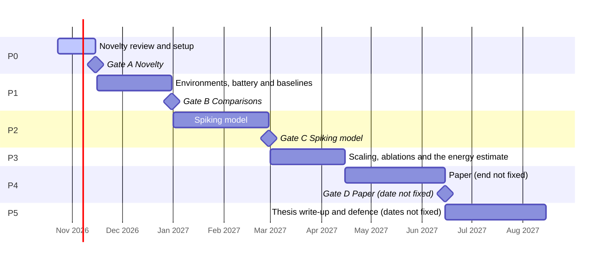
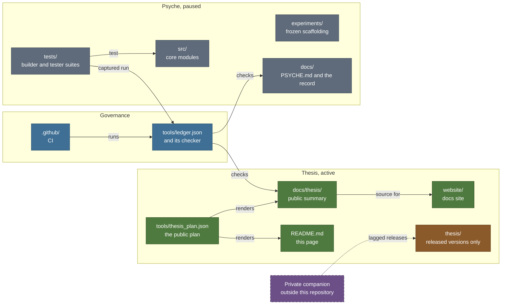

# Psyche

> **Cognitive Map Formation and Energy Efficiency in Spiking Neural Networks with Local Plasticity**
>
> Psyche, the dependency-free memory-and-activation substrate this repository was built for, is
> paused ([D-031](DECISIONS.md)); its code, tests and published record remain here intact.

This repository now serves an undergraduate thesis in computer engineering / artificial
intelligence. It carries the thesis's public summary and Psyche's complete record.

---

## Status at a glance

<!-- generated:status-line:start -->
**Now:** P0 Novelty review and setup (2026-10-23 to 2026-11-15) · **Next gate:** A Novelty, 2026-11-15
<!-- generated:status-line:end -->

The status line, the roadmap chart and the gate table on this page are generated from
[`tools/thesis_plan.json`](tools/thesis_plan.json), the only source of thesis dates. No date is
typed by hand.

---

## The thesis in one minute

Classic animal experiments, from Tolman's mazes onward, describe behaviour such as learning a
maze without reward, taking a detour and finding a shortcut. Tolman argued that an internal map
of the environment explains such behaviour better than memorised stimulus-response associations
do. The thesis asks whether a brain-inspired
network of spiking neurons that learns only through local synaptic plasticity can show those
behaviours, and what they cost as an analytic estimate of synaptic operations.

Every agent, the spiking model and the baseline agents alike, receives the same pre-generated
exploration of the same environments and is scored by the same test battery, built from classic
paradigms: latent learning, detour, shortcut, structural transfer and transitive inference. Each
agent is reported on three axes: behaviour on the battery, the structure of its internal
representations, and the estimated synaptic operations.

The plan is layered so that it does not rest on its riskiest part. The environments, the battery
and the comparisons form a safe base that stands on its own; if the spiking model falls short, a
documented account of where and why is kept as a result.

What it does not claim: nothing about cognition beyond the measurable class of behaviour the
battery tests, nothing about how animals solve the task, and no priority. Energy enters only as an analytic
estimate, never as a hardware reading. There are no results yet; these pages describe a plan.

The full overview, with the research questions and the evaluation pipeline, is in
[docs/thesis/README.md](docs/thesis/README.md).

---

## Roadmap

The work runs in phases from a novelty review to the written thesis and its defence. Most phases
close at a decision gate.

<!-- generated:plan-gantt:start -->

<!-- generated:plan-gantt:end -->

The phase table, the layers and the paper submission deadline are on the
[roadmap](docs/thesis/roadmap.md); each phase's outputs are listed in
[`tools/thesis_plan.json`](tools/thesis_plan.json).

---

## Decision gates

A gate is a fixed point in the plan where a decision is taken against criteria written in
advance. The question and the fallback are public; the criteria are written before the work
they judge and stay private until submission. Public status reads `upcoming` or `decided`,
without the verdict.

<!-- generated:gates-table:start -->
| Gate | Title | Date | Status | Question |
|---|---|---|---|---|
| A | Novelty | 2026-11-15 | upcoming | Is the thesis's combination of aims new, or is its difference from the closest published work written down and defensible? |
| B | Comparisons | 2026-12-31 | upcoming | Do the environments, the battery and the baseline agents run, and do the baselines reproduce the behaviour their papers report? |
| C | Spiking model | 2027-02-28 | upcoming | Does the spiking model meet its pre-registered behavioural criteria on the battery? |
| D | Paper | one week before the submission deadline | upcoming | Are all figures, the multi-seed results and the ablations in, and have external readers' comments been worked in? |
<!-- generated:gates-table:end -->

Each gate is described on [Decision gates](docs/thesis/gates.md).

---

## Public and private

- **Public here:** the overview, roadmap, gates, test battery, claims discipline and engineering
  standards, plus Psyche's full record.
- **Private until submission:** hypotheses beyond the research questions, the criteria, the
  experiment plan, the model (its code is released later, see below), and the related-work
  analysis, all held in a private companion.
- **Released later:** thesis code reaches `thesis/` only as older, complete, working versions,
  under the [disclosure policy](docs/thesis/disclosure-policy.md).

---

## How Psyche relates to the thesis

The thesis reuses how Psyche was built and checked, and some of its tooling, but none of its
model code.

- **One ledger, one checker.** Psyche keeps every quoted count and status in one file that a
  checker enforces; the thesis keeps its public plan in one file, and every page that shows a
  phase, gate or date renders from it.
- **Pre-registration before any graded run.** Criteria are fixed before the work they judge, and
  Psyche's three walls serve as a checklist of failure modes to rule out beforehand.
- **Determinism and an independent tester.** Bit-exact checks across interpreters and hash
  seeds wherever a result allows it, with each result stating its determinism tier, and hostile
  tests written separately from the code they attack.

Psyche's components are not parts or ancestors of the thesis model, and its results are evidence
about Psyche only. The full account is in
[docs/thesis/psyche-and-the-thesis.md](docs/thesis/psyche-and-the-thesis.md).

---

## Psyche (paused): what is built

Psyche is a dependency-free Python prototype of a memory-and-activation substrate for a cognitive
architecture. A graph store of concept nodes and weighted roads feeds a deterministic
spreading-activation engine, and the cycle closes end to end: perceive, activate, cluster,
compete, prune, and one bounded broadcast that biases the next cycle. Its assurance comes in three
tiers kept strictly apart: the substrate and activation layers are proven correct and
deterministic, the closed cycle is tester-verified as mechanism with no cognitive meaning claimed,
and the experiment scaffolding is exploratory.

A behavioural claim was attempted three times and stopped three times, each before any graded
number existed and each at a structurally distinct wall: semantic priming was circular, the fan
effect found the mechanism absent, and interoception found the signal flat. The finding is scoped
to this substrate and these three yardsticks. The record at the pause, mirrored in
[`tools/ledger.json`](tools/ledger.json) and swept under six hash seeds:
26 suites, 2,645 assertions, 0 failures on CPython 3.10–3.14.
The full record is in [docs/PSYCHE.md](docs/PSYCHE.md).

---

## Repository map

| Path | Purpose | State |
|---|---|---|
| `src/` | Psyche core modules, standard library only | paused |
| `tests/` | Psyche builder suites and independent tester suites, kept passing | paused |
| `experiments/` | Psyche's exploratory experiment scaffolding and its captured results | frozen |
| `tools/` | The ledger and its checker, the capture tools, the thesis plan, the publishing tools | active |
| `docs/thesis/` | The thesis's public summary | active |
| `docs/PSYCHE.md` | Psyche's former README, kept intact apart from the edits its banner lists | paused |
| `docs/` (Psyche record) | Architecture, methodology, specs, the archived report and the held paper | paused |
| `thesis/` | The thesis package, filled only by release | export-only |
| `website/` | The docs site (in progress), designed to take its content from the governed pages | active |
| `.github/` | CI workflows that run the checks | active |



---

## Running things

Psyche's suites run on the Python standard library alone; there is nothing to install.

```bash
# every registered suite, with the correct PYTHONPATH handled for you:
python3 run_tests.py

# documents against the ledger; C2 is left out while the paper is held (D-012, D-031):
python3 tools/ledger_check.py --only C1,C3,C4,C5,C6
```

The suites use a small built-in harness and run as scripts, not under pytest. The thesis package
under `thesis/` is separate: it installs with its own pinned dependencies once a version is
released, and `run_tests.py` never runs it.

---

## Citation

This work is archived on **Zenodo** with a permanent DOI:
**<https://doi.org/10.5281/zenodo.20474613>**

If you use or reference Psyche, please cite:

> Caliskan, C. (2026). *Nous: Adversarial Testing of a Dependency-Free Memory-and-Activation
> Substrate for Cognitive Architectures.* Zenodo. https://doi.org/10.5281/zenodo.20474613

The **report is open access under CC BY 4.0**; the **code is MIT-licensed** (see
[LICENSE](LICENSE)). A machine-readable [`CITATION.cff`](CITATION.cff) is provided at the
repository root.

---

## License

MIT: see [LICENSE](LICENSE). Copyright (c) 2026 Cagan Caliskan.
