<!--
  MASTER SOURCE OF TRUTH for the Nous technical report.
  The LaTeX (docs/report/nous_report.tex) and Word (docs/report/nous_report.docx)
  deliverables are rendered from THIS file and must be kept in sync in content.

  HARD RULES (do not relax):
   - Every number is taken verbatim from docs/TEST_OUTPUT.txt and the measured stats
     in README.md. Do not recompute or estimate.
   - Nous is an engineering prototype AND a testing-methodology case study: never a
     mind, consciousness, AGI, or a validated cognitive model. The cognitive layers
     are exploratory; their meaningfulness is explicitly not claimed.
   - Neuroscience/cognitive theories are conceptual inspiration only: never
     "implemented" or "reproduced"; no claims of biological fidelity.

  BEFORE SUBMISSION: verify exact page numbers / DOIs for every reference in §11.
  The citation list is curated but page-level details should be checked against the
  primary sources.
-->

# Nous: Adversarial Testing of a Dependency-Free Memory-and-Activation Substrate for Cognitive Architectures

### An Engineering and Methodology Case Study

**Author:** Cagan Caliskan
**Year:** 2026
**Artifact:** `nous/`: pure-Python standard-library prototype; 5 modules, 5 test suites; MIT-licensed.

---

## Abstract

This report describes **Nous**, a dependency-free Python prototype of a memory-and-activation
substrate for a cognitive architecture, and (more centrally) the **software-engineering
methodology** used to build it. Nous comprises four layers: a graph *substrate store* of concept
nodes and weighted "roads"; a deterministic *spreading-activation* engine; a multi-source
*activation field*; and a thin end-to-end *perceive → activate → form coalitions → select a
thought* slice. The lower two layers are verified, by an adversarial property-style test suite,
for three concrete properties: **determinism** (identical output across process runs, confirmed in
fresh interpreters under randomized hash seeds), **integrity** (graph indices stay mutually
consistent across every mutation), and **purity** (reads never mutate stored state). The upper two
layers are **exploratory**: they run and are deterministic, but their cognitive *meaningfulness is
explicitly not claimed*, and on clustered real input the end-to-end slice produces an *incoherent*
"thought," which is recorded as an asserted **negative result / known limitation**, not a
contribution. The central finding is a recurring failure mode: a component that *passes on a
friendly, hand-chosen input and fails on an adversarial or system-generated one*, and the two
practices that caught it: **adversarial/property-based testing** (including cross-process
determinism and read-purity checks) and **loop-closure** (driving each stage with
system-generated rather than hand-placed inputs). Together they exposed **six distinct structural
bugs** that ordinary happy-path tests pass over. The artifact's verified totals: **130 assertions
across 56 test functions, all passing, in five suites.**

---

## 1. Introduction

Most write-ups of ambitious systems describe what the system is meant to become. This one separates
that aspiration from what was actually built and proven, and reports the engineering discipline in
between. The subject is a cognitive-architecture prototype; the contribution is the **testing
methodology** applied to it.

**Motivation:** Cognitive-architecture components (graph memories, spreading activation, clustering
into "coalitions") are easy to implement in a way that *looks* correct on a hand-built example and
is quietly wrong in structure: it double-counts, it depends on iteration order, it bakes the answer
into the input. These are not typos; they are bugs in the *shape* of the algorithm, and they
survive happy-path tests. The question this project answers in the affirmative is whether a
disciplined, adversarial, property-oriented test process can surface such bugs early and force the
honest scoping of what has and has not been achieved.

**Aspiration vs. built reality:** Nous began as a large design vision. Those original vision
documents are retained verbatim in the repository under `docs/design/`, but they are **quarantined
as aspiration**: a disclaimer there states plainly that their grand language ("AGI," "a real
brain," "mind," "felt experience") describes intent, not the built code, and that of the thirteen
documents only the two layer-plan files correspond to anything implemented. This report concerns
**only the built artifact** and is bound by the scope below.

**Scope and non-claims (binding):**

- Nous is an **engineering prototype** and a **testing-methodology case study**.
- It is **not** a mind, consciousness, AGI, or a validated cognitive model, and makes **no claim of
  machine cognition**.
- The substrate store and spreading-activation engine are **proven** deterministic,
  integrity-preserving, and pure. These are claims about *mechanism*.
- The field, coalition, and "thought" layers are **exploratory**. Their cognitive meaningfulness is
  **not established**; the incoherent-thought behavior on clustered real input is an **honest
  negative result**, not a feature.
- Named neuroscience and cognitive theories are **conceptual inspiration** only. Nothing here
  *implements* or *reproduces* them, and no biological fidelity is claimed.

**Contributions (methodology first):**

1. **A software-engineering experience report** showing that adversarial/property-based testing
   (determinism verified across process hash seeds, and read-purity verified by hammering reads) and
   **loop-closure** caught a sequence of **six structural bugs** in a memory/activation substrate.
2. A **verified substrate**: a graph store and a spreading-activation engine that are deterministic,
   integrity-preserving, and pure, with the verification shipped as runnable tests.
3. An **honestly-scoped exploratory cognitive layer**, including an *asserted* known-limitation test
   that encodes a negative result as a standing, checkable claim.
4. A **reusable discipline**: phrased as transferable lessons (§6.8) about how "passes on a friendly
   input" recurs and how to design tests and inputs that defeat it.

---

## 2. Background and related work

The following bodies of work **inspired** the design's vocabulary and structure. Nous does not
implement, validate, or reproduce any of them, and claims no biological fidelity; each is named to
position the prototype, not to assert a result.

**Complementary Learning Systems (CLS):** The fast/slow split between a rapidly-learning episodic
system and a slowly-consolidating semantic one [1], updated for intelligent-agent design in [2],
*inspires* Nous's separation of **activation** (what lights up now) from **consolidation** (what is
later reinforced). In the prototype this appears only as a strict rule: spreading activation is a
pure read and never strengthens what it touches, not as a consolidation system.

**Synaptic Tagging and Capture (STC):** The hypothesis that a weak event sets a local "tag" that can
capture plasticity-related products from a nearby strong event [3, 4] *inspires* the framing of
reinforcement as a *gated, budgeted* event. Nous borrows the framing to justify keeping activation
read-only; it does not model tagging dynamics.

**Global Workspace Theory (GWT):** The idea that specialized processes form coalitions that compete,
and a winner is broadcast globally [5, 6], is the source of Nous's *coalition* vocabulary. Only
coalition **formation** exists in the code; the competition/broadcast step is an explicit,
unbuilt placeholder.

**LIDA cognitive cycle:** LIDA's systems-level *perceive → attend → broadcast* cycle [7] loosely
shapes the staging of the end-to-end slice. The slice realizes only the early stages.

**Cognitive architectures:** ACT-R's integrated theory of cognition [8] and SPAUN's large-scale
functional brain model [9] are referenced for **positioning**: Nous is far smaller and makes no
behavioral or biological claims; it is a substrate-and-method study, not an architecture in their
sense.

**Spreading-activation theory:** Nous's activation engine is a deterministic, engineered variant of
spreading activation in the sense of Collins & Loftus [10]; the convergence-sums property is taken
from that lineage, while the hop-layered single-expansion is an engineering choice made for
determinism (§6).

**Arousal and plasticity:** The Yerkes–Dodson inverted-U relating arousal to performance [12]
appears in the design notes as motivation for emotion-modulated plasticity; in the code this is only
charge-modulated strengthening and is best read as design-level aspiration.

**Semantic priming** [10, 11] is named here because it is the worked example for future validation
(§9): an effect whose direction is known independently of Nous.

---

## 3. System architecture (as built)

Nous is pure-Python standard library, organized bottom-up. Each layer reads the one below through
its public surface only. Figure 1 makes the honest boundary visual: the lower two layers are proven,
the upper two are exploratory.

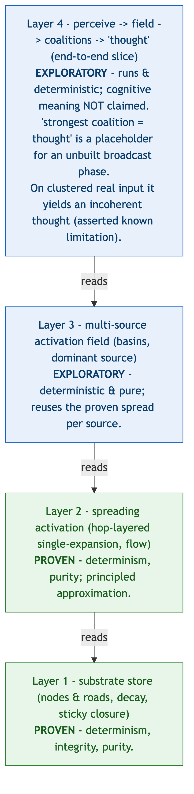

**Figure 1: The four-layer stack and the honest boundary.** Layers 1–2 (substrate store, spreading
activation) are **PROVEN** (determinism, integrity, purity); layers 3–4 (multi-source field, end-to-end
slice) are **EXPLORATORY**. The figure establishes *where verification stops*; it does **not** claim the
exploratory layers are cognitively meaningful.

### 3.1 Substrate store (`nous_store.py`, 548 lines)

The only component that mutates the graph; it holds no cognitive logic.

- **Nodes and roads:** A `Node` is an always-neutral unit of information with a stable identity and a
  content string. A `Road` is a *directed* edge `source → target` carrying a scalar `strength`
  (edge weight; a new road starts at `0.05`) and a *multi-valued* emotional life `charges` (named
  feelings → intensity in `[-1, 1]`), from which an aggregate `valence` is derived. There is **one
  road per `(source, target)` pair** (a dedup index); the reverse direction is a distinct road.
- **Stable identity vs. ordering:** Every node and road has a stable `uuid4` identity and is never
  addressed by position; a stale handle therefore resolves to `NotFound`, never to a wrong object.
  Formation order, when needed, is a **separate integer `creation_seq`**, kept distinct from identity
  precisely so that ordering never has to fall back to a uuid (§6.4).
- **Lazy, pure-read decay:** Roads decay with elapsed time, but decay is **computed on access as a
  read-only view**: a read returns a *copy* carrying decayed values and never writes. Only writes
  persist decay. The strength time-constant scales steeply with strength
  (`tau = 45 · exp(strength · 4.2)`), so a "highway" is far more stable than a "dirt track"; charge
  mellows on a slower clock. This purity is load-bearing and is the subject of finding (a).
- **Sticky closure:** A strongly-negative crossing (or one-shot trauma) **closes** a road; closure is
  re-evaluated *only on an active crossing*, never by a read or by the passage of time, and only an
  active positive crossing reopens it. Avoidance preserves the closed state rather than dissolving it.
- **Pin guard and integrity:** `remove_node` refuses to delete a *pinned* node (the mechanism behind
  a higher layer's "do not prune what is in use" policy). Adjacency, dedup, and designation
  consistency are asserted incrementally on every mutation, with a full-graph scan available offline.
- **Atomicity:** Every mutation is a synchronous method with no `await` inside, making each mutation
  atomic by construction under single-threaded asyncio.

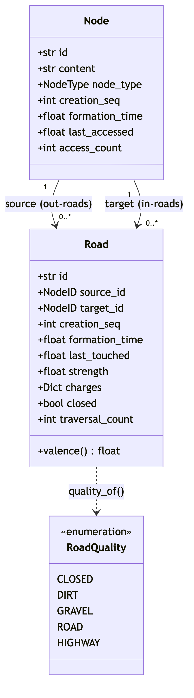

**Figure 2: Substrate data model.** The `Node` and `Road` fields; identity (`uuid4`) is deliberately
separate from ordering (`creation_seq`). Describes the data structures only.

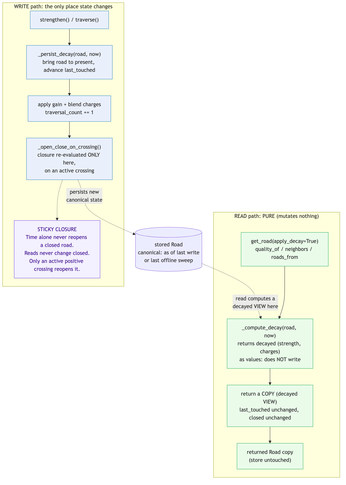

**Figure 3: Read vs. write paths (the purity invariant).** Reads compute decay into a *copy* and never
mutate; only writes persist decay; closure changes only on an active crossing. Visualizes finding (a);
it proves a *mechanism* property, not anything about cognition.

### 3.2 Spreading activation (`nous_activation.py`, 281 lines)

The first operation that reads *across* the graph: radiate activation from a seed along directed
out-roads and report what lit up. **Pure read:**

- **Convergence sums:** Activation arriving at a node from several paths is summed: a node lit from
  several directions is more active.
- **Hop-layered single-expansion:** The wave expands in hop layers; all hop-*k* contributions
  accumulate before any hop-*k* node expands, each node expands **exactly once**, and a per-layer
  **frozen snapshot** is used for expansion so that same-hop ("intra-layer") edges cannot leak
  iteration order into the result. Equal-length convergence is therefore **exact**, and the
  algorithm is a deterministic function of store state. This replaced an earlier priority-frontier
  design (findings (b), (c)).
- **Two attenuators:** Transmitted activation is `outgoing · road.strength · decay_per_hop`:
  `road.strength` is **edge conductance** (a property of the connection); `decay_per_hop` is a
  **global distance penalty** (a property of the spread). They are kept separate deliberately.
- **Leaky closure:** A single swappable policy governs closed roads: below a breakthrough threshold
  nothing crosses; above it, a small attenuated fraction leaks through and the event is logged. The
  constants are **uncalibrated guesses on probation**; the tests pin only the qualitative regime.
- **Flow recording:** The engine records, per edge, the activation actually transmitted (`flow`),
  distinct from static topology: a blocked road carries no flow, a leaked road carries attenuated
  flow. Downstream consumers read `flow`, not raw edges.
- **Locality:** A hop budget and an activation floor keep the spread in the seed's neighborhood,
  which is what makes it affordable in pure Python.

### 3.3 Multi-source activation field (`nous_field.py`, 161 lines)

Runs the proven single-source spread once **per source** and assembles a field: each node's
activation from each source, the **summed total** across sources, and the **dominant source** (the
one that activates it most: the node's *basin*). Dominant-source ties break on the stable
`creation_seq`, so the field is deterministic given store state. Pure read. This exists because a
*single* seed yields one activation peak, so any segmentation of it keys off distance from the seed
rather than community structure (finding (e)); multiple sources yield multiple genuine peaks.

### 3.4 Coalitions and the end-to-end slice (`nous_coalitions.py` 324 lines; `nous_perceive.py` 162 lines)

- **Coalition formation** groups co-activated nodes. Two entry points exist: a *flow-cut*
  segmentation of a single spread (cut the region at weak-flow edges), and a *group-by-basin* path
  for the multi-source field. Every output-affecting order is an explicit total order over intrinsic,
  reproducible keys (activation, then `creation_seq`), never set-iteration order.
- **Perception** turns text into sources: tokens (length ≥ 3) are matched by substring against node
  content, and matched nodes become activation sources with energy scaled by match count. This is
  deliberately minimal: exact/substring matching, no embeddings, but it makes the sources
  **input-derived rather than hand-placed**.
- **The slice** (`think`) runs `perceive → build field → form coalitions by basin → select the
  strongest coalition as "the thought."` The final step, *"strongest coalition = thought,"* is an
  explicit **placeholder** standing in for an unbuilt workspace-competition / broadcast phase. The
  slice is pure and deterministic; what it produces is **not** claimed to be meaningful (finding (f),
  §7.3).

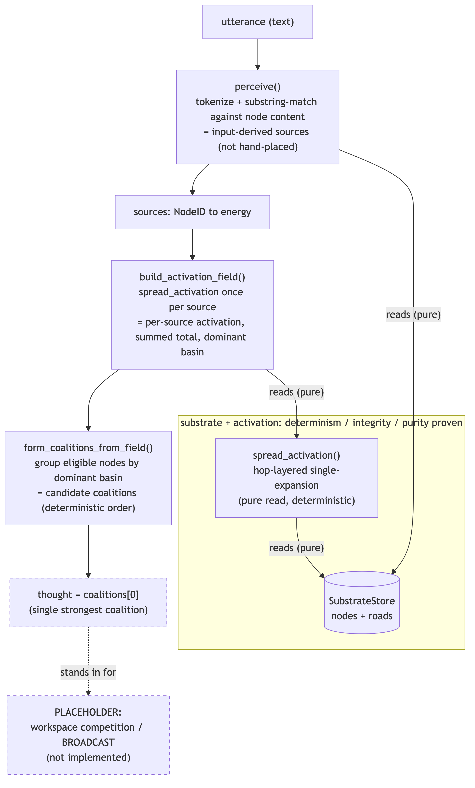

**Figure 4: End-to-end "thought" slice.** `text → perceive → field → coalitions → thought`. The final
"strongest coalition = thought" step is a **placeholder** for an unbuilt broadcast phase. The figure
shows *data flow*; it does **not** assert the resulting "thought" is meaningful.

---

## 4. Methodology

The central claim of this report is that the test process (not the prototype) is the contribution. Two
properties were treated as first-class and verified directly.

**Property-based / adversarial testing:** Each component ships with tests written to *break* its
central claim, not to confirm it on an easy case: lopsided edge strengths, intra-layer edges,
equal-activation rings, and a two-dense-communities-joined-by-a-thin-bridge graph built specifically
to defeat distance-based segmentation.

**Determinism across processes, not within one:** The natural implementations leak `set`-iteration
order over `uuid4` keys into their results. Within a single process the hash seed is fixed, so this
cannot be seen; the determinism tests therefore spawn **fresh interpreters** with different
`PYTHONHASHSEED` values and compare output byte-for-byte. The activation suite uses seeds
{0, 1, 3, 7, 42}; the coalition and field suites use {0, 1, 2, 3, 7, 42, 123, 999} (eight seeds); the
slice uses {0, 1, 2, 7, 42, 999}.

**Read-purity as an asserted invariant:** Read-only operations are run in tight loops and the full
canonical (un-decayed) store state is asserted byte-equal before and after, in every layer.

**The harness, and a deliberate non-use of pytest:** The suites use a tiny built-in harness: each
`check(...)` / `expect_raises(...)` increments a counter, and the suite prints `RESULT: N passed,
M failed` and exits non-zero on any failure. They are intentionally **not** pytest tests: pytest
would collect the `test_*` functions but would not register a logical `check(False, …)` as a failed
assertion, so it could report green on a real failure. The honest runner is `run_tests.py`, which
sets an absolute `PYTHONPATH` (required so the determinism subprocesses resolve their imports
regardless of working directory) and propagates non-zero exit codes.

---

## 5. Findings overview

Read findings (b)–(f) together and one shape repeats: **a component passes on a friendly,
hand-chosen input and fails on an adversarial or system-generated one.** Each fix had two parts:
write the test that *tries to break* the claim, and make the inputs *system-generated* rather than
hand-chosen so a stage can no longer be validated against a fiction of what feeds it. The six
findings below are each presented as: *claim under test → bug → root cause → fix → the specific test
that now locks it.* Every claim is traceable to the code and the named test; reported magnitudes that
the shipped artifact does not let one reproduce are omitted rather than asserted.

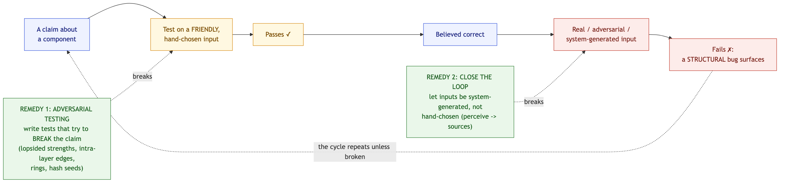

**Figure 5: The recurring "friendly-input" failure mode, and the two remedies.** Conceptual: the loop
shared by findings (b)–(f), broken by adversarial testing and by closing the loop. It illustrates the
*method*; it asserts no measurement.

---

## 6. The six structural findings

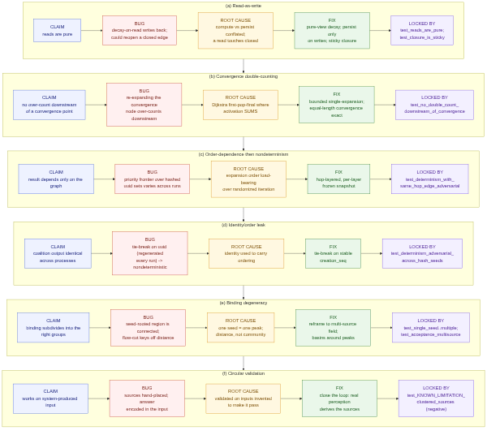

**Figure 6: The six structural findings at a glance.** Each row: *claim → bug → root cause → fix →
locking test*. Every cell traces to a module docstring and a named test; no error magnitudes are
asserted (the report omits the ones the artifact cannot reproduce).

### 6.1 (a) Read-as-write: a read that could silently re-open a closed wound

- **Claim under test:** reads are pure; stored state changes only on writes.
- **Bug:** the natural implementation applies time-decay on access and writes it back, so every read
  mutates the store; worse, if decay also re-evaluated closure, repeated reads over time could let a
  *closed* (traumatic) edge drift back open with no crossing ever reopening it.
- **Root cause:** conflating "compute the current value" with "persist the current value," and
  letting a passive read touch state (`closed`) that should change only on an active event.
- **Fix:** split decay into a pure view (`_compute_decay`, returns decayed values without mutating;
  `get_road` returns a *copy*) and a persisting write (`_persist_decay`, called only by
  writes/offline). Decay never touches `closed`; closure is sticky.
- **Locked by:** `test_reads_are_pure` (many reads change nothing stored), `test_lazy_decay` (the
  read view shows decay while the canonical value is unchanged), `test_closure_is_sticky` (time +
  repeated reads do not reopen a closed road; only an active positive return does).

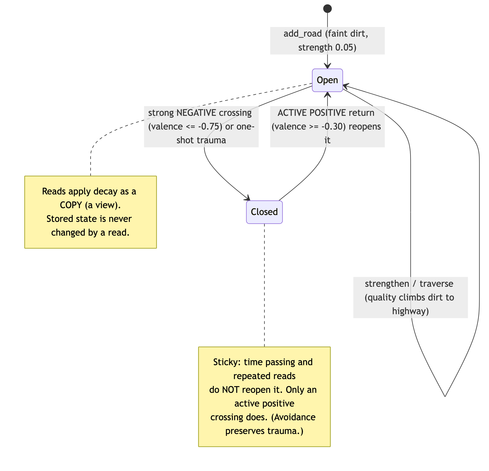

**Figure 7: A road's closure lifecycle (finding (a) invariant).** `Open ⇄ Closed` transitions happen
*only* on active crossings; time passing and reads never reopen a closed road. A mechanism property,
asserted by `test_closure_is_sticky`.

### 6.2 (b) Convergence double-counting: "first-pop-final" where activation sums

- **Claim under test:** a node downstream of a convergence point is not over-counted.
- **Bug:** when activation converges from several paths it must sum, but re-expanding the convergence
  node as later paths raise its value counts everything downstream multiple times.
- **Root cause:** importing Dijkstra's "first-pop-final" intuition into an algorithm where activation
  *accumulates* rather than being a shortest-path minimum.
- **Fix:** bounded single-expansion, hop-layered: each node expands exactly once carrying the full
  sum of paths of length ≤ its settle hop; equal-length convergence is exact.
- **Locked by:** `test_no_double_count_downstream_of_convergence`, which uses **deliberately
  lopsided** edge strengths to prove the result does not depend on them, asserts the downstream child
  receives the convergence node's full value exactly once, and includes an explicit guard that the
  result is *strictly below* what additive re-expansion would produce (the old bug's signature);
  `test_convergent_activation_sums` confirms convergence does sum.

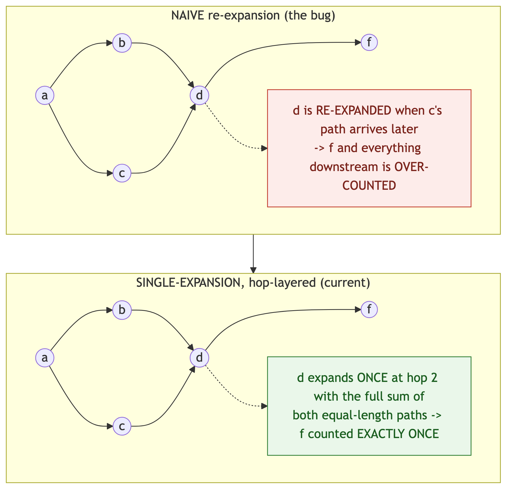

**Figure 8: Convergence double-counting, before/after (finding (b)).** Structural schematic of the
diamond-with-tail: naive re-expansion over-counts everything downstream of the convergence node;
single-expansion counts it once. No magnitudes are shown (the report omits them as not reproducible).

### 6.3 (c) Order-dependence, then nondeterminism: a priority frontier over hashed sets

- **Claim under test:** post-convergence activation depends only on the graph, never on expansion
  order or process hash seed.
- **Bug:** an activation-priority frontier made *which* late ripple was dropped depend on incidental
  edge-strength ordering; and with same-hop edges, which sibling expanded first was decided by
  iterating a `set` of uuids: order randomized per process by `PYTHONHASHSEED`, so results swung
  across runs.
- **Root cause:** letting expansion order be load-bearing for the result, over a container whose
  iteration order is intentionally randomized.
- **Fix:** hop-layered expansion with **per-layer frozen values**: a layer's expansion snapshot is
  fixed before any node in it expands, so an intra-layer edge's contribution propagates only in the
  next layer; expansion reads only the frozen snapshot.
- **Locked by:** `test_expansion_is_deterministic_under_edge_strength` (same topology under lopsided /
  moderate / balanced strengths gives the same relationship), and the decisive
  `test_determinism_with_same_hop_edge_adversarial`, which builds an intra-layer edge and re-runs the
  spread in fresh interpreters under `PYTHONHASHSEED ∈ {0,1,3,7,42}`, asserting the result is
  byte-identical across seeds.

### 6.4 (d) Identity/order leak: tie-breaking on a uuid regenerated every run

- **Claim under test:** coalition output (partition, ordering, representatives) is identical across
  processes.
- **Bug:** coalition ordering and representative selection tie-broke on the node id, but ids are
  `uuid4`, regenerated every run, so any tiebreak falling back to the id was nondeterministic across
  processes even when the structure was identical.
- **Root cause:** using identity (intentionally non-stable across runs) to carry ordering.
- **Fix:** tie-break on the stable `creation_seq` integer; `representative()` orders by
  `(−activation, creation_seq)` and the coalition sort key is `(−strength, −size, min creation_seq)`.
- **Locked by:** `test_determinism_adversarial_across_hash_seeds`, which builds a ring of
  equal-activation nodes plus tie-strength singletons, serializes by stable keys (content +
  `creation_seq`, never uuid), and asserts identity across 8 hash seeds;
  `test_representative_is_most_active_deterministically`.

### 6.5 (e) Binding degeneracy: components on a graph connected by construction

- **Claim under test:** coalition binding subdivides a co-activated region into the right groups.
- **Bug, two stages:** (1) Connectivity binding is structurally degenerate: a seed-rooted spread's
  co-activated subgraph is **connected by construction**, so connected-components always yields *one*
  coalition. (2) Flow-magnitude cutting does subdivide, but for a single seed the only strong signal
  is **distance from the seed**, and flow magnitude is even *anti-correlated* with community
  membership near the seed (a seed-adjacent bridge edge carries more flow than distant intra-cluster
  edges, so it is preserved while genuine internal edges are cut).
- **Root cause:** a single seed produces one activation peak and monotonically-decaying flow; any
  segmentation of it keys off distance, not community.
- **Fix:** keep flow-cut as the single-seed segmenter (it does yield more than one coalition) but
  recognize the real problem is *upstream* and reframe to a **multi-source field**: multiple sources →
  multiple genuine peaks → basins around peaks.
- **Locked by:** `test_single_seed_spread_yields_multiple_coalitions` (flow-cut yields > 1 coalition
  on a real spread) and `test_acceptance_multisource_recovers_communities` (the field recovers exactly
  the two communities on the adversarial bridge graph that single-seed segmentation could not).

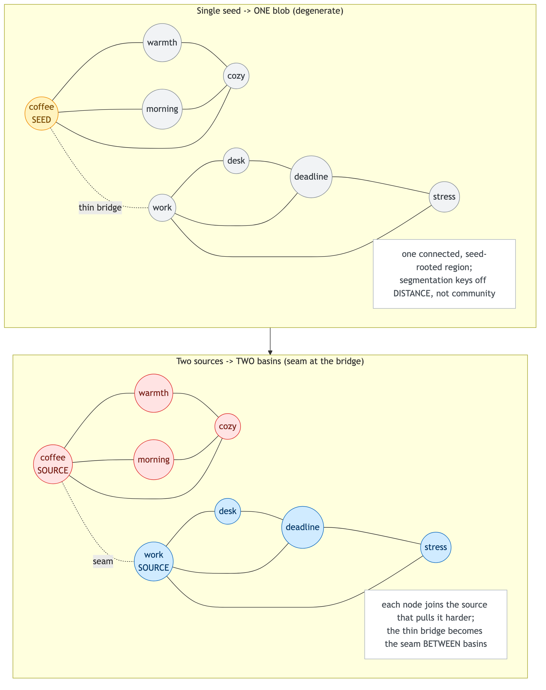

**Figure 9: Single-seed degeneracy vs. multi-source basins (finding (e)).** The same
two-communities-with-a-thin-bridge graph: one seed yields a single distance-keyed blob; two sources
yield two basins with the bridge as the seam. The multi-source recovery is the asserted acceptance test
:  in which the two sources are *placed one per community* (see finding (f) for why that matters).

### 6.6 (f) Circular validation: the answer hand-encoded in the input

- **Claim under test:** the cognitive layer works on input the *system* produced, not input chosen to
  make it work.
- **Bug:** every layer above the substrate had been validated against a fiction of what would feed it.
  Sources were **hand-placed**, and this culminated in the field acceptance test recovering two
  communities *only because one source was hand-placed at the center of each*: the answer was encoded
  in the input. (This is visible in the artifact: `test_acceptance_multisource_recovers_communities`
  does place one source per community by hand. It is honest as a *mechanism* test and would be
  dishonest if read as evidence that the system finds communities on its own.)
- **Root cause:** validating a stage against inputs invented to produce the desired output.
- **Fix:** **close the loop** with the thinnest real slice (`nous_perceive.py`): `text → perceive →
  sources → field → coalitions → thought`, where which nodes become sources is decided by the input
  matched against the substrate, not by the test. On real clustered input the field then produces an
  **incoherent** "thought": basins collapse, one source over-swallows across domains, and same-domain
  sibling sources strand as singletons.
- **Locked by, as a *limitation*, not a result:**
  `test_KNOWN_LIMITATION_clustered_sources_give_poor_basins` *asserts the failure on purpose*: it
  confirms three same-domain sources were perceived, then asserts the "thought" over-swallows and that
  a perceived same-domain source strands as a singleton. The test is written to flip to green only when
  source-grouping is fixed: the limitation is encoded as a standing, checkable claim.

### 6.7 What the six have in common

(b)–(f) are all instances of "passes on a friendly input." (a) is the dual lesson for *invariants*:
a property (purity) that an easy test trivially satisfies can be violated by an interaction
(decay × closure × time) that only a purpose-built test exercises. In every case the bug was
structural, and in every case the catching test was adversarial or loop-closing.

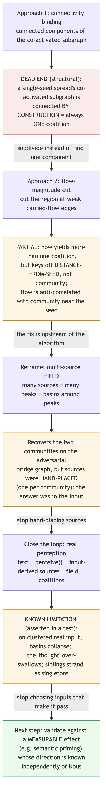

**Figure 10: The cognitive-layer arc and its dead-ends.** connectivity binding → flow-cut →
multi-source field → closed-loop, and what each step revealed (findings (e), (f)), ending at the
known limitation. It documents the *development path*, not a working capability.

### 6.8 Transferable lessons

1. **Test the property, not the example:** purity, determinism, and "no double-count" are
   properties; assert them directly and across processes, not by spot-checking outputs.
2. **Randomize what you assume is fixed:** running under multiple `PYTHONHASHSEED` values is what
   makes uuid-set nondeterminism observable.
3. **Close the loop:** let a stage's inputs be produced by the stage below it; hand-chosen inputs
   hide both degeneracy and circularity.
4. **Encode known limitations as asserted tests:** a negative result written as a failing-on-purpose
   assertion is a standing, checkable claim, not a comment that rots.

---

## 7. Results

### 7.1 Verified properties (the positive results)

For the substrate store and the spreading-activation engine, the test suite establishes, as runnable
checks:

- **Determinism:** identical output across process runs, confirmed in fresh interpreters under the
  hash seeds listed in §4.
- **Integrity:** graph indices, adjacency, dedup, and designations remain mutually consistent across
  every mutation; a full-graph scan finds no drift.
- **Purity:** reads never mutate stored state; lazy decay is a read-only view.

These are claims about **mechanism**: the code does exactly and only what it says, reproducibly. They
are *not* claims that the mechanism reproduces any cognitive phenomenon.

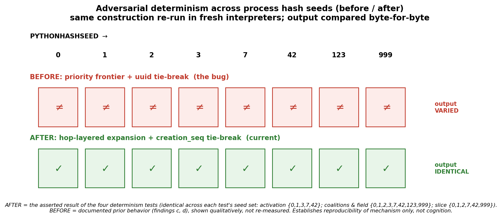

**Figure 11: Adversarial determinism across process hash seeds (before/after).** *AFTER* is the
asserted, byte-identical result of the four determinism tests (each across its own seed set); *BEFORE*
is the documented prior bug (findings (c), (d)), shown qualitatively and **not** re-measured. It
establishes reproducibility of *mechanism* only, not cognition.

### 7.2 Test suite

All figures below are taken verbatim from `docs/TEST_OUTPUT.txt` (CPython 3.13.2, Darwin 24.5.0
arm64) and re-confirmed by `python3 run_tests.py` for this report. Every suite passes with zero
failures.

| Suite | Layer | Checks passed |
|---|---|---:|
| `test_nous_store.py` | substrate store | 45 |
| `test_nous_activation.py` | spreading activation | 35 |
| `test_nous_coalitions.py` | coalition formation | 19 |
| `test_nous_field.py` | multi-source field | 13 |
| `test_nous_perceive.py` | perception + end-to-end slice | 18 |
| **Total** | | **130 passed, 0 failed** |

The total is **130 assertions executed across 56 test functions**, including the cross-process
determinism checks and one explicitly-asserted known-limitation test. The verbatim run is reproduced
in Appendix A.

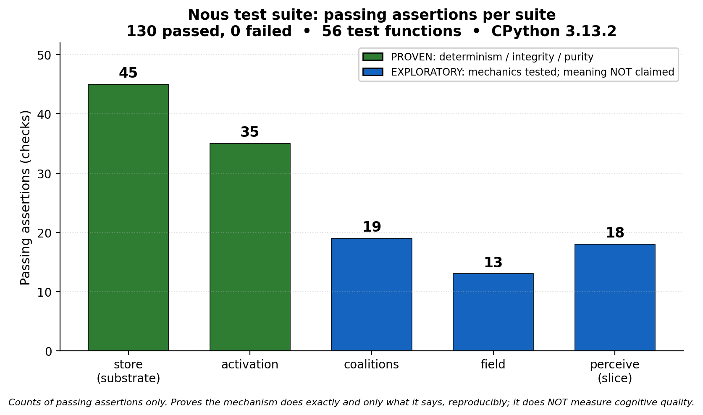

**Figure 12: Passing assertions per suite (130 total, 0 failed).** Counts taken verbatim from
`docs/TEST_OUTPUT.txt`. Proves *mechanism* (and the *mechanics* of the exploratory layers); it does
**not** measure cognitive quality. The proven/exploratory colouring matches Figure 1.

**Code size (measured):**

| | Files | Lines (`wc -l`) | Non-blank, non-comment |
|---|---:|---:|---:|
| Source modules (`src/`) | 5 | 1,476 | 1,058 |
| Test suites (`tests/`) | 5 | 1,555 | 1,223 |
| **Python total** | **10** | **3,031** | **2,281** |

Per module (`wc -l`): `nous_store.py` 548, `nous_activation.py` 281, `nous_coalitions.py` 324,
`nous_field.py` 161, `nous_perceive.py` 162.

### 7.3 The incoherent-thought known limitation (an asserted negative result)

On clustered real input the end-to-end slice does **not** produce coherent coalitions. When
perception lights up several nodes in the same domain, basins collapse: one source over-swallows
across domains while same-domain siblings strand as singletons. This is asserted on purpose by
`test_KNOWN_LIMITATION_clustered_sources_give_poor_basins`, which passes today *because the failure
holds*; it is written to flip only when the underlying source-grouping problem is solved. It is
reported here as a **negative result**, not a contribution.

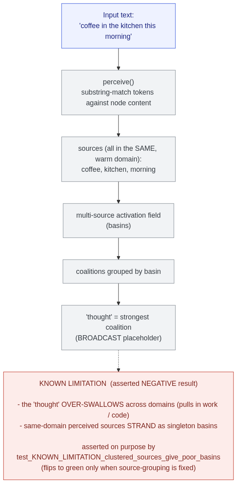

**Figure 13: The closed-loop slice and its honest failure (finding (f); asserted NEGATIVE result).**
On the real input *"coffee in the kitchen this morning,"* the "thought" over-swallows across domains
(pulls in *work*/*code*) and same-domain perceived sources strand as singleton basins: asserted by
`test_KNOWN_LIMITATION_clustered_sources_give_poor_basins`. This figure documents a **known
limitation**, not a capability.

### 7.4 What these results do and do not establish

They establish that the substrate and activation engine are correct, deterministic, integrity-
preserving, and pure, and that the cognitive layers run deterministically and purely. They do **not**
establish that any "thought" the cognitive layers produce is cognitively meaningful; on the contrary,
the one end-to-end behavioral probe on real input is a documented failure. "The mechanism is correct
and deterministic" and "the mechanism reproduces a cognitive phenomenon" are different claims; this
work earns the first and explicitly does not claim the second.

---

## 8. Limitations and threats to validity

- **Cognitive meaningfulness is unestablished:** The field/coalition/thought layers are exploratory;
  the only end-to-end behavioral result on real input is the negative one in §7.3.
- **Uncalibrated constants on probation:** The closed-road breakthrough threshold/leak fraction and
  the coalition flow-cut fraction are first-pass guesses. The tests pin only the qualitative regime
  (weak cues blocked, strong cues leak; weak-flow edges cut), never the magnitudes, and nothing
  downstream may depend on the numbers.
- **Perception is exact/substring matching only:** No embeddings or fuzzy semantics; it is the minimal
  step that makes sources input-derived.
- **Out-roads-only spread (v1):** Activation follows directed out-roads; backward spread along
  in-roads is a deliberate later addition.
- **Determinism is "given store state," not over the abstract graph:** The proven property is that the
  output is a deterministic function of the *store's state*, where state includes the integer
  `creation_seq` assigned in build order. Two stores that are isomorphic as abstract graphs but built
  in a different order can therefore differ in `creation_seq` and, where ties are broken on it, can
  produce different (but each individually deterministic and reproducible) tie-break orderings.
  Determinism here means *reproducibility across process runs of the same construction*, not
  invariance under graph isomorphism.
- **Scale is unverified:** All tests are small graphs; the prototype makes no scaling claims.

---

## 9. Future work

The natural next step is to stop validating the cognitive layer against hand-built inputs and instead
validate it against a **measurable cognitive effect whose direction is known independently of Nous**.
**Semantic priming** is the worked example: in human studies, recognizing a target word is faster
when preceded by a related prime than an unrelated one [11], a result that the spreading-activation
account explains via pre-activation spreading to related concepts [10]. A priming-style protocol for
Nous would pre-activate a related concept and test whether the target's activation is measurably
raised relative to an unrelated control: a directional prediction made *before* running the system,
so the input is no longer chosen to make the answer come out right (closing the loop, as in §6.6, at
the level of evaluation). Two further items follow directly from the findings:

- **The source-grouping problem (from finding (f)):** Same-domain perceived sources must be grouped or
  merged before basins are meaningful; solving it is the condition under which the §7.3 known-limitation
  test would flip to green.
- **A real broadcast/competition phase:** The "strongest coalition = thought" placeholder should be
  replaced by an actual workspace competition, at which point the uncalibrated constants can begin to
  be calibrated against a running cycle rather than guessed.

---

## 10. Conclusion

What was earned is concrete and modest: a correct, deterministic, integrity-preserving, and pure
memory-and-activation substrate, built in dependency-free Python and shipped with the tests that prove
those properties across process hash seeds, and, above it, an honestly-scoped exploratory layer whose
one end-to-end behavioral probe is a documented negative result. The larger contribution is the
**method**: adversarial/property-based testing and loop-closure caught six structural bugs that
happy-path testing passes over, and the same discipline drew the boundary the project refuses to
cross: proving mechanism while explicitly declining to claim cognition. What remains open is exactly
what the method recommends next: evaluate the cognitive layer against an effect whose direction is
known independently, fix the source-grouping degeneracy, and build the competition phase that would
make the constants calibratable. The honest version of "it works" used throughout this project is the
useful one: *this part is proven; that part is not, and here is the failing test that says so.*

---

## 11. References

> **Note to the author:** this list is curated and the bibliographic details are believed correct, but
> **verify exact page numbers, volumes, and DOIs against the primary sources before submission:**

[1] McClelland, J. L., McNaughton, B. L., & O'Reilly, R. C. (1995). Why there are complementary
learning systems in the hippocampus and neocortex: Insights from the successes and failures of
connectionist models of learning and memory. *Psychological Review, 102*(3), 419–457.

[2] Kumaran, D., Hassabis, D., & McClelland, J. L. (2016). What learning systems do intelligent agents
need? Complementary Learning Systems theory updated. *Trends in Cognitive Sciences, 20*(7), 512–534.

[3] Frey, U., & Morris, R. G. M. (1997). Synaptic tagging and long-term potentiation. *Nature, 385*,
533–536.

[4] Redondo, R. L., & Morris, R. G. M. (2011). Making memories last: the synaptic tagging and capture
hypothesis. *Nature Reviews Neuroscience, 12*, 17–30.

[5] Baars, B. J. (1988). *A Cognitive Theory of Consciousness.* Cambridge University Press.

[6] Dehaene, S., & Changeux, J.-P. (2011). Experimental and theoretical approaches to conscious
processing. *Neuron, 70*(2), 200–227.

[7] Franklin, S., Madl, T., D'Mello, S., & Snaider, J. (2014). LIDA: A systems-level architecture for
cognition, emotion, and learning. *IEEE Transactions on Autonomous Mental Development, 6*(1), 19–41.

[8] Anderson, J. R., Bothell, D., Byrne, M. D., Douglass, S., Lebiere, C., & Qin, Y. (2004). An
integrated theory of the mind. *Psychological Review, 111*(4), 1036–1060.

[9] Eliasmith, C., Stewart, T. C., Choo, X., Bekolay, T., DeWolf, T., Tang, Y., & Rasmussen, D. (2012).
A large-scale model of the functioning brain. *Science, 338*(6111), 1202–1205.

[10] Collins, A. M., & Loftus, E. F. (1975). A spreading-activation theory of semantic processing.
*Psychological Review, 82*(6), 407–428.

[11] Meyer, D. E., & Schvaneveldt, R. W. (1971). Facilitation in recognizing pairs of words: Evidence
of a dependence between retrieval operations. *Journal of Experimental Psychology, 90*(2), 227–234.

[12] Yerkes, R. M., & Dodson, J. D. (1908). The relation of strength of stimulus to rapidity of
habit-formation. *Journal of Comparative Neurology and Psychology, 18*(5), 459–482.

---

## Appendix A: Verbatim test output

The following is the captured run from `docs/TEST_OUTPUT.txt` (section headers preserved; per-suite
result lines in bold are the source of the totals in §7.2).

```
NOUS SUBSTRATE STORE: TEST SUITE (Layer 1)        → RESULT: 45 passed, 0 failed   [exit 0]
NOUS SPREADING ACTIVATION: TEST SUITE             → RESULT: 35 passed, 0 failed   [exit 0]
NOUS COALITION FORMATION: TEST SUITE              → RESULT: 19 passed, 0 failed   [exit 0]
NOUS MULTI-SOURCE FIELD + FIELD COALITIONS         → RESULT: 13 passed, 0 failed   [exit 0]
NOUS PERCEPTION + END-TO-END SLICE: TEST SUITE    → RESULT: 18 passed, 0 failed   [exit 0]
                                                     TOTAL: 130 passed, 0 failed
```

The complete, unabridged capture (including every individual check label and the
`KNOWN LIMITATION` note) is the file `docs/TEST_OUTPUT.txt` in the repository.

## Appendix B: Reproduction

```bash
# all five suites (handles the absolute PYTHONPATH for the determinism subprocesses):
python3 run_tests.py

# a single suite directly:
PYTHONPATH="$PWD/src" python3 tests/test_nous_store.py
```

Pure standard library; no dependencies (developed and captured on CPython 3.13.2). The suites use a
built-in harness and must be run as scripts, not under pytest (§4).

## Appendix C: Figure index and sources

All figures are embedded inline in the sections above. Their **editable sources** and
**presentation-resolution renders** live in the repository:

- **Mermaid diagrams:** source `docs/diagrams/*.mmd`, rendered `docs/diagrams/rendered/*.png` (the
  `.mmd` files also render crisply at mermaid.live or via `mmdc`).
- **Data charts:** matplotlib scripts `docs/diagrams/figures/*.py` (run them to regenerate the PNGs at
  `dpi=200`), rendered `docs/diagrams/rendered/*.png`.

| Fig | Section | Asset name (in `docs/diagrams/`) | Kind |
|---:|---|---|---|
| 1 | §3 | `architecture_stack` | Mermaid |
| 2 | §3.1 | `data_model` | Mermaid |
| 3 | §3.1 | `substrate_read_write` | Mermaid |
| 4 | §3.4 | `pipeline` | Mermaid |
| 5 | §5 | `friendly_input_loop` | Mermaid |
| 6 | §6 | `six_findings` | Mermaid |
| 7 | §6.1 | `sticky_closure_state` | Mermaid |
| 8 | §6.2 | `convergence_before_after` | Mermaid |
| 9 | §6.5 | `single_seed_vs_multisource` | Mermaid |
| 10 | §6.7 | `cognitive_evolution` | Mermaid |
| 11 | §7.1 | `figures/determinism_seeds.py` | matplotlib |
| 12 | §7.2 | `figures/test_suite_bars.py` | matplotlib |
| 13 | §7.3 | `closed_loop_known_limitation` | Mermaid |
| 14 | this appendix | `repo_map` | Mermaid |

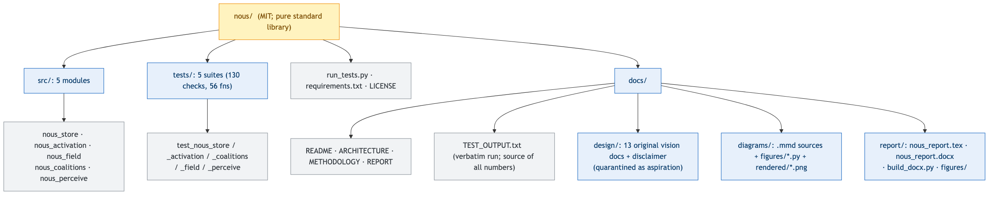

**Figure 14: Repository / asset map.** Orientation only; it shows the package layout, not behavior.
