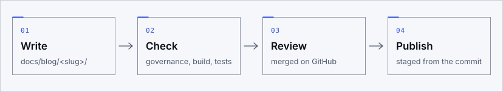

Psyche is an open research project that builds brain-inspired components in stages, with
artificial general intelligence as its long-term aim. Most of what it publishes is reference
material: the pages of this site, written to be read in any order and kept current. This blog is
the other kind of page, a dated one. A post says what was true on its day and stays as it was
written; a correction made later carries the day it was made.

## What the posts cover

The posts stay inside what is already public:

- **The substrate, stage 1.** What it built and verified, the
  [negative results](../../three-walls.md) that stopped each attempt at a cognitive claim before
  any graded run, and what that pattern shows. Its development is paused, and its record stays
  maintained.
- **How the work is done and checked.** Test-first, adversarial development, the
  [methodology](../../METHODOLOGY.md) behind it, the [engineering standards](../../research/engineering.md)
  of stage 2, and the tools that tie every public number to its single source.
- **The reading behind the cognitive-map line.** The classic work on the
  [reading list](../../research/reading-list.md) and the published paradigms of the
  [test battery](../../research/test-battery.md).
- **The plan, once a change to it is public.** A phase started or finished, a gate decided. Those
  are recorded on the [progress page](../../progress.md), which has a feed of its own; a post may
  explain one, and never comes before it.

## What they do not cover

Stage 2, spiking cognitive maps, is active, and its current state is private. The
[disclosure policy](../../research/disclosure-policy.md) withholds its hypotheses beyond the
research questions, its pre-registered criteria, its experiment plan, the model and its code, its
working records and, apart from the outcomes a progress note reports, its results. A post is bound
by that policy like every other page. A decided gate shows only the day it was decided and what
follows it. So a post about this stage is one of two things. It reports what has been released and
explains what is already on these pages, or it is a progress note: it reports what was achieved (a
milestone, a count, whether a check met the criterion fixed for it, a failure) and never how the
work is done.

The posts also keep to the project's [claims discipline](../../research/claims-and-scope.md): no
component is described as more than it has been shown to be, and AGI is named only as the aim.

## How a post reaches the site

A post is a Markdown file in the repository, under `docs/blog/`. It reaches the site the way every
docs page does: from a reviewed commit, through the same checks. Those checks read it for counts
that disagree with the project's ledger, for claim terms the project rules out, for material the
disclosure policy withholds and for language, and the build of the site checks its links, its head
and its accessibility. A post that fails one of them is not published, and what no check can read,
such as its tone, is for the review before it is merged. The steps for writing one are in
[the blog's guide](../README.md).

## Following it

Every post is listed on the [blog's index](https://cagancaliskan.github.io/psyche/blog/), and the
[blog feed](https://cagancaliskan.github.io/psyche/blog.xml) carries each one from the day it is
published. Questions about a post go to
[GitHub Discussions](https://github.com/cagancaliskan/psyche/discussions); a wrong claim or a
broken link goes to the [bug report form](https://github.com/cagancaliskan/psyche/issues/new/choose).
