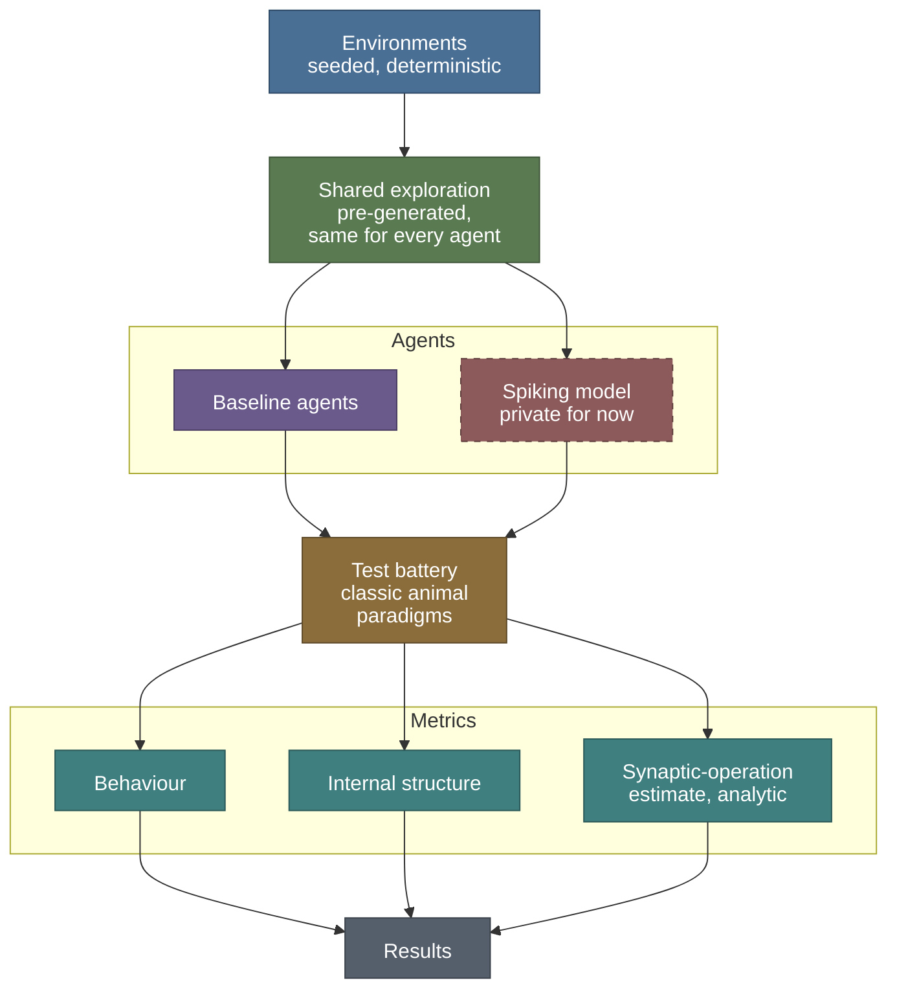

# Spiking cognitive maps: overview

> Public summary. Detail is withheld until submission under the [disclosure policy](disclosure-policy.md).

**Cognitive Map Formation and Energy Efficiency in Spiking Neural Networks with Local Plasticity**

Stage 2 of Psyche, an open research project building toward artificial general intelligence
(AGI), and the project's active line of research since 2026-10-23.

<!-- generated:status-line:start -->
**Now:** P0 Novelty review and setup (2026-10-23 to 2026-11-15) · **Next gate:** A Novelty, 2026-11-15
<!-- generated:status-line:end -->

The phase, gate and deadline tables and every date on these pages are generated from one
file, [`tools/research_plan.json`](../../tools/research_plan.json); dates are never typed by
hand. The line builds on stage 1, the substrate, whose code and full record stay in this
repository, summarised in [PSYCHE.md](../PSYCHE.md). How the substrate led to this line, and what
carries over from it, is told in [Origins](origins.md).

## Motivation

Edward Tolman's maze experiments with rats, summarised in Tolman (1948), are the classic
evidence that animals learn more than the responses they are rewarded for. In latent-learning
experiments, rats that explored a maze without reward showed little sign of having learned it;
once food was placed at the goal, their performance soon matched that of rats rewarded from the
start. In shortcut experiments, when the familiar route was blocked, rats chose routes they had
never taken that led roughly toward the goal. Tolman argued that such behaviour is better
explained by an internal map of the environment, a cognitive map, than by chains of learned
stimulus-response associations.

Later work found cells whose activity is tied to space. Place cells in the hippocampus fire
when an animal is in a particular part of its environment (O'Keefe and Dostrovsky, 1971). Grid
cells in the medial entorhinal cortex fire at many locations that together form a regular
triangular lattice across the environment (Hafting et al., 2005). These findings motivate
brain-inspired models of map learning. They do not by themselves say how a map is learned.

The open question this line takes up is narrower: whether behaviours that only an internal
map explains can arise in a network of spiking neurons that learns only through local synaptic
plasticity (see the [glossary](glossary.md)), and what such behaviour costs in estimated
synaptic operations.

## Aim

The line is framed as a test. It asks:

- whether a spiking network, loosely inspired by hippocampal circuitry and trained only with
  local synaptic plasticity, shows on classic cognitive-map tests the behaviours that an
  internal map explains and memorised responses do not;
- whether other families of agents, given the same experience, show them too;
- how many synaptic operations the spiking network needs, estimated analytically.

The plan does not depend on a positive answer. The environments, the battery, the comparisons
and the analysis form a safe base that stands on its own. If the spiking model falls short, a
documented account of where and why is kept as a result in its own right
([roadmap.md](roadmap.md)).

## Research questions

Questions only. Hypotheses, pass criteria and the method behind each answer are withheld until
submission.

| # | Question |
|---|---|
| RQ1 | Can a network of spiking neurons that learns only through local synaptic plasticity form a cognitive map of its environment? |
| RQ2 | Does it show behaviours that memorised stimulus-response associations cannot explain? |
| RQ3 | Do place-like representations emerge in the network without being built in? |
| RQ4 | What does the behaviour cost, expressed as an analytic estimate of synaptic operations? |

## Planned contributions

These are plans, not results.

1. **A spiking model that learns only through local plasticity**, evaluated on the public battery
   below, with what it does and does not show reported either way. The model stays private until
   its release under the [disclosure policy](disclosure-policy.md).
2. **An open cognitive-map test battery** derived from classic animal-behaviour paradigms
   (latent learning, detour, shortcut, structural transfer, transitive inference), with
   comparisons across families of agents. See [test-battery.md](test-battery.md).
3. **A measurement framework** that reports every agent on three axes: behaviour on the
   battery, the structure of its internal representations, and an analytic estimate of its
   synaptic operations.

## What this line does not claim

- **No general claim about cognition.** "Cognitive map" names a measurable class of behaviour:
  behaviour that memorised stimulus-response associations cannot explain and an internal model
  of the environment can. Passing a test is evidence of that behaviour and nothing more. Words
  for mental states are not applied to the model; results describe behaviour and internal
  structure.
- **Brain-inspired, not a statement about biology.** The model is described as brain-inspired
  and, where it can be argued, biologically plausible. Matching an animal's behaviour on a test
  is not evidence that animals solve the task the same way.
- **Energy only as an estimate.** Energy enters only as an analytic estimate of synaptic
  operations, read as a lower bound under stated assumptions. Nothing is measured on hardware.
  There is no general claim that spiking networks cost less than conventional ones; any
  comparison holds for this task, this metric and these assumptions.
- **No priority claim.** Whether the combination of aims is new is the question of a decision
  gate ([gates.md](gates.md)). These pages make no priority claim.
- **No claim of general intelligence.** AGI is the long-term aim of the whole project, named only
  as an aim. This line studies one measurable class of behaviour, and nothing on these pages
  presents its model as general intelligence or as a measured step toward it.
- **No results yet.** These pages describe a plan. Any number reported later will come from a
  captured results file.

The full discipline, including scope and writing rules, is in
[claims-and-scope.md](claims-and-scope.md).

## Evaluation pipeline

The evaluation is model-agnostic. Every agent receives the same pre-generated exploration of
the same environments and is scored by the same battery and the same metrics.

Read from top to bottom: seeded environments produce one shared exploration; the baseline agents
and the spiking model all learn from it; the same battery tests every agent; and each agent is
reported on the same three metrics, which together form the results.

The line's code, the battery included, is developed privately and reaches this repository only
as lagged releases, under [`cogmap/`](../../cogmap/README.md) and the
[disclosure policy](disclosure-policy.md). The spiking model stays private until its release.

## Pages

| Page | What it covers |
|---|---|
| [Roadmap](roadmap.md) | Phases, layers and deadlines, generated from the plan file |
| [Gates](gates.md) | The decision gates, the question each one answers, and what happens if one is missed |
| [Test battery](test-battery.md) | The classic paradigms behind the battery, the environment families and the fairness rules |
| [Claims and scope](claims-and-scope.md) | What the line may and may not claim, what is in and out of scope, and the writing rules |
| [Engineering](engineering.md) | Coding standards, reproducibility, determinism, statistics and figures |
| [Glossary](glossary.md) | Terms used on these pages |
| [Reading list](reading-list.md) | Classic background reading |
| [Origins](origins.md) | How stage 1, the substrate, led to this line: what carries over, what does not, and where it points |
| [Disclosure policy](disclosure-policy.md) | What is public, what is withheld, and when it is released |

Back to the [repository README](../../README.md).
