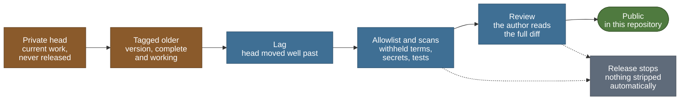

# Disclosure policy

> Public summary of the release rule. The full policy is private.

This repository carries a public summary of the cognitive-map line, stage 2 of Psyche. The
detail, the line's code and its working records live in a private companion repository. Material moves from there to here only
under the rule on this page. The decision that set up this split is recorded in
[DECISIONS.md](../../DECISIONS.md) as D-031.

The purpose of the rule is narrow: a public version must never contain the code, comments or
documents that would let a reader catch up with the current state of the work. Everything below
follows from that.

## What is public now

| Material | Where |
|---|---|
| The overview of the line: title, aim, research questions as questions, planned contributions, non-claims | [Overview](README.md) |
| Phases, layers, deadlines and their dates | [Roadmap](roadmap.md), generated from [`tools/research_plan.json`](../../tools/research_plan.json) |
| The decision gates: the question each one asks, its fallback, its public status | [Gates](gates.md) |
| The test battery: the classic paradigms, the environment families, the fairness rules | [Test battery](test-battery.md) |
| What the line may and may not claim | [Claims and scope](claims-and-scope.md) |
| Coding, reproducibility and statistics standards | [Engineering](engineering.md) |
| Terms and background reading | [Glossary](glossary.md), [Reading list](reading-list.md) |
| The substrate, stage 1: its code, tests and published record, and how it led to this line | [PSYCHE.md](../PSYCHE.md), [Origins](origins.md) |
| Pre-registration commitments: a date and a hash for each frozen file | [Below](#pre-registration-without-disclosure) |

No code of this line is public yet. When it is released, it appears under
[`cogmap/`](../../cogmap/README.md) at the repository root, by release only. Nobody edits that
folder directly.

## What is withheld

Withheld material is named here by category only. A precise description of what is withheld
would itself be a hint, so this page goes no further than the list.

- Hypotheses beyond the research questions as stated in the [overview](README.md).
- Pre-registered criteria and thresholds, including what counts as passing a gate.
- The experiment plan: which experiments are run, in what order and in what combinations.
- The model: how it works, and its code.
- The analysis of related work and how the line is positioned against it.
- Results, logs and other working records.
- The paper draft.

## The release rule

> Publish complete, working, older versions. Never the current state.

A release is allowed only when all of these hold:

1. **It is a tagged version.** Releases come from a tag in the private companion that marks a
   complete, working version, never from work in progress.
2. **It is old enough.** The tagged version is at least eight weeks behind the private head, and
   the head has moved past it. The current state is never released, even when it is complete.
3. **Its group may be released.** The release group's earliest-release condition holds (see
   [Release groups](#release-groups)).
4. **It works standalone.** In a fresh environment, its own tests pass on the exported tree
   alone, with no private code present.
5. **It is clean and reviewed.** The exported tree passes every scan, and the author has read the
   full diff and approved it.

The export is taken from the tag itself, not from a working copy, and carries no version history.
A default-deny allowlist decides which files leave; anything not on it stays private. The
exported tree is then scanned for withheld terms, secrets, private paths, excluded files and
Turkish characters, since this repository is English-only. A failed scan stops the release. Nothing is stripped automatically to make
a release pass.

The release tooling is built when the earliest release is due. Until then, no code of this line
moves to this repository at all.

A release moves from left to right only while every step holds: the private head is never
released, an older tagged version must lag well behind it, and the export must pass the
allowlist, the scans and its standalone tests before the author reviews the full diff. A failed
scan or a review that does not approve stops the release (the dashed arrows), and nothing is
stripped automatically to make it pass.

## Release groups

The line's code is released in groups. Each group has an earliest-release condition, and the lag
applies on top of it: a group is released only after its condition holds and only from a version
that also meets the release rule.

| Group | Contents | Earliest release |
|---|---|---|
| Battery | The environments, the test battery, the agent interface, the random and shortest-path reference agents, the behaviour and statistics metrics, and their public tests | After paper submission |
| Operation counter | The counter behind the analytic estimate of synaptic operations, and its tests | After paper submission |
| Model | The spiking model: only the version that was submitted, never a later one | After the review decision |

Never released through this process: experiment configurations, pre-registration files before
their reveal, notebooks, raw data and results files, logs, the line's private decision
records, the paper source before acceptance, and the release tooling itself.

## Pre-registration without disclosure

The criteria behind each gate are written before the work they judge (see [Gates](gates.md)).
To show in public that they were fixed in advance, without disclosing them:

1. When a pre-registration file is frozen, a line holding a random nonce is added to it.
2. The SHA-256 hash of the whole file, nonce line included, is taken.
3. An entry is added to `commitments` in [`tools/research_plan.json`](../../tools/research_plan.json):
   an id, the date, a one-line subject, the hash, and when the file will be revealed.
4. At submission the file is published unchanged, and anyone can recompute the hash.

The date is public from the day of the commitment; the content is not. The nonce stops anyone
from recovering a short file by hashing plausible guesses until one matches. A frozen file that
changed afterwards would no longer match its hash, so a change needs a new commitment and a
recorded reason, never a silent edit.

To check a revealed file against its commitment, hash it and compare the result with the table:
`shasum -a 256 FILE` on macOS, or `sha256sum FILE` on Linux.

The table below is generated from the plan file and is not edited by hand. While no file has
been frozen, the table shows a single "none yet" row.

<!-- generated:commitments-table:start -->
| ID | Date | Subject | SHA-256 | Reveal |
|---|---|---|---|---|
| none yet | — | — | — | — |
<!-- generated:commitments-table:end -->

## Gate status without verdicts

Public status words are lowercase and few:

| Applies to | Words |
|---|---|
| Phases | planned, active, done |
| Gates | upcoming, decided |
| Deadlines | upcoming, met, missed |

When a gate is decided, its public status changes to `decided` and nothing more. Whether it was
passed is not shown. Verdicts are disclosed at submission, because an early verdict tells a
reader how far the work has come and which route it is on. A phase's status says what is being
worked on, not how well it is going. [Gates](gates.md) describes each gate and its fallback.

## Double-blind review

- **An anonymous artifact.** For submission, a separate anonymous artifact is built from the
  submission tag: what reviewers need to reproduce the results, with no version history and with
  names, affiliations and links removed.
- **No link from the submission.** This repository is never linked from the submission, and the
  submission does not depend on anything here.
- **A quiet repository during review.** While the paper is under review, the pages of this line
  change only in plan status. No text from the submission appears here.

## English only

Everything in this repository is in English. Public pages are written fresh for this repository
rather than translated or redacted from private documents, so no private wording carries over.
Code meant for release, with its comments and documentation, is written in English from the
start.

Back to the [overview](README.md) or the [repository README](../../README.md).
