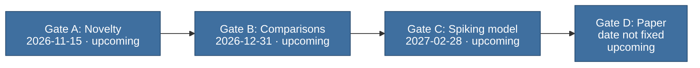

# Decision gates

> Public summary. Detail is withheld until submission under the [disclosure policy](disclosure-policy.md).

The plan of the cognitive-map line, stage 2 of Psyche, has decision gates labelled A to D. A gate
is a fixed point in the plan where a decision is taken against criteria written in advance. Each
gate falls at or near the end of a phase of the [roadmap](roadmap.md), and the decision sets the
route the next phase takes.

## Why gates exist

The decisions that shape the line are taken at fixed points, not gradually and not after the
convenient answer is known. Each gate has three parts:

| Part | What it is | Where it lives |
|---|---|---|
| Question | What the gate decides | Public, in the plan |
| Criteria | What counts as a yes, written before the work they judge | Private until submission |
| Fallback | The route taken if the answer is no, also fixed in advance | Public, at summary level |

Criteria are written in advance so that a result cannot reshape the test it is judged by.
Changing a criterion after it has been written needs a recorded decision with its reason; it is
never a silent edit. This is the same discipline the substrate, stage 1 of Psyche, applied to its
pre-registrations (see [Origins](origins.md)).

Missing a gate sends the work along the fallback fixed in advance for it; it does not by default
end the line. The plan is layered so that the line stands on its safe base even if the spiking
model does not work, and a documented account of where and why it fell short is kept as a result
in its own right. The layers are described in the [roadmap](roadmap.md). After any gate, the
next step is one of three: the line continues to the next phase, extends, or stops (see
[what the public status means](#what-the-public-status-means)).

## The gates at a glance

The table and the flow below are generated from
[`tools/research_plan.json`](../../tools/research_plan.json), the only source of gate dates, and are
not edited by hand.

<!-- generated:gates-table:start -->
| Gate | Title | Date | Status | Question |
|---|---|---|---|---|
| A | Novelty | 2026-11-15 | upcoming | Is this line's combination of aims new, or is its difference from the closest published work written down and defensible? |
| B | Comparisons | 2026-12-31 | upcoming | Do the environments, the battery and the baseline agents run, and do the baselines reproduce the behaviour their papers report? |
| C | Spiking model | 2027-02-28 | upcoming | Does the spiking model meet its pre-registered behavioural criteria on the battery? |
| D | Paper | one week before the submission deadline | upcoming | Are all figures, the multi-seed results and the ablations in, and have external readers' comments been worked in? |
<!-- generated:gates-table:end -->

<!-- generated:gate-flow:start -->

Each arrow leads to the next gate in plan order. If a gate is missed:

- **Gate A** (Novelty): Reposition the contribution and record the decision privately before work continues.
- **Gate B** (Comparisons): Extend briefly, then narrow the baseline set to the strongest published reference.
- **Gate C** (Spiking model): Shift the submission target; the work proceeds on the safe base and the failure analysis.
- **Gate D** (Paper): A workshop paper and a preprint; a later main-track venue.
<!-- generated:gate-flow:end -->

The flow shows the four gates in order, each with the route the work takes if that gate is
missed. The sections below describe each gate in turn.

## Gate A: Novelty

Gate A closes the phase "Novelty review and setup". It asks whether this line's combination of
aims is new. If closely related work has been published, the gate asks instead whether the
difference from it is written down and can be defended.

If the answer is no, the contribution is repositioned, and that decision is recorded privately
before work continues. The public record of any gate decision is only its date and the next step (see
[what the public status means](#what-the-public-status-means)).

## Gate B: Comparisons

Gate B closes the phase "Environments, battery and baselines". It asks two things: whether the
environments, the [test battery](test-battery.md) and the baseline agents all run, and whether
the baseline agents reproduce the behaviour that published work reports for them. A comparison
means little if the reference agents do not behave as published, so the references are checked
before anything is compared against them.

If the answer is no, the phase is extended briefly; if the baselines still fall short, the
baseline set is narrowed to the strongest published reference.

## Gate C: Spiking model

Gate C closes the phase "Spiking model". It asks whether the spiking model meets its
pre-registered behavioural criteria on the battery. Which tests and environments those criteria
cover is withheld until submission.

If the answer is no, the submission target shifts, and the work proceeds on the safe base and the
failure analysis.

## Gate D: Paper

Gate D falls near the end of the paper phase, shortly before submission to a major peer-reviewed
ML venue (2027). It asks whether the paper is complete in substance: all figures, the multi-seed
results and the ablations are in, and the comments of external readers have been worked in. Its
date is tied to the submission deadline, which has not been announced; the plan records the rule.

If the answer is no, the route becomes a workshop paper and a preprint, with a later main-track
venue.

## What the public status means

Each gate shows one of two public status words:

| Status | Meaning |
|---|---|
| upcoming | The decision has not been taken yet. |
| decided | The decision has been taken against its criteria. The public record holds two facts and no others, listed below. |

When a gate is decided, the public record states only:

- **The date it was decided.**
- **The next step:** the line continues to the next phase, extends, or stops.

The gate table shows both in the Status cell of a decided gate. Nothing else about a decision is
public: no verdict detail, no evidence and no reasoning ([D-034](../../DECISIONS.md)). The next
step says whether the line goes on, not why. The full record of a decision stays in the private
companion repository and moves here only under the [disclosure policy](disclosure-policy.md).
How the plan is edited when a gate is decided is described on the [roadmap](roadmap.md).

The site also reads each gate against the day a page is opened. A gate whose date has passed with
no recorded decision shows as "decision pending", with its date. After a decision that stops the
line, the gates behind it show as "not reached". Both are display wording only; the plan's status
words stay upcoming and decided.

A decision does not lift a claim rule. A term that the [claims discipline](claims-and-scope.md)
forbids before a gate stays forbidden until release, whatever the outcome. A decided Gate A, in
particular, does not allow a priority claim.

The criteria behind each gate are pre-registered privately. When a criteria file is frozen, a
salted SHA-256 hash of it is added to the commitments list in the plan, with the date. The date
is public from that moment; the content is published at submission, and anyone can then check it
against the hash. The [disclosure policy](disclosure-policy.md) describes the procedure.

Gate dates can move. A moved date keeps its original baseline in the plan, and the move needs an
entry in the change log of the public plan file; the [roadmap](roadmap.md) explains how dates
change.
