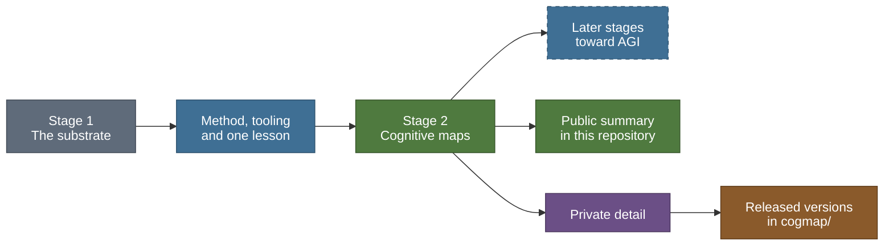

# Origins: from the substrate to cognitive maps

> Public summary. Detail is withheld until submission under the [disclosure policy](disclosure-policy.md).

Psyche is one open research project building toward artificial general intelligence (AGI), named
here only as its long-term aim. It grows in stages. This page tells how the first stage, the
substrate, led to the second, spiking cognitive maps: what the substrate built and showed, what
carries over into the new line, what does not, and where the stages point.

The short version: the substrate gave the project its method, its tooling and one hard lesson
about evidence. The cognitive-map line is built around that lesson. It is a separate codebase and
shares no code with the substrate's core.

## Stage 1: the substrate

The substrate is a dependency-free Python memory-and-activation substrate for a cognitive
architecture, built test-driven on the standard library alone and verified by an independent
adversarial tester. A graph store of concept nodes and weighted roads feeds deterministic
spreading activation, a multi-source activation field and source clustering; a workspace runs one
competition, prunes activated material that no perceived input supports, and broadcasts back
within a bounded budget. The cycle closes end to end.

What it proves is mechanism: its lower layers are correct and deterministic, reproducibly, and
its closed cycle is tester-verified as mechanism. It makes no cognitive claim. It is archived on
Zenodo ([doi:10.5281/zenodo.20474613](https://doi.org/10.5281/zenodo.20474613)), and its full
account is in [PSYCHE.md](../PSYCHE.md).

Its development has been paused since 2026-10-23 under D-031 in
[DECISIONS.md](../../DECISIONS.md), so that the cognitive-map line can run at full pace: no new
brick starts and no default changes, while the suites, the ledger, its checker and the
determinism sweep stay maintained. The pause changes no brick status, meaning verdict or test
figure; every registered suite still passes with no failures, as the ledger records.

## The aims

Two aims are recorded in [`tools/ledger.json`](../../tools/ledger.json), both as aims and never
as properties of any system.

The project's long-term aim (D-033) is artificial general intelligence, built from original,
brain-inspired components. Nothing built so far is general intelligence, and no page here
presents any component as having reached that aim.

The substrate's own aim is narrower:

> a biologically grounded, non-LLM memory-and-activation substrate that moves information without loss and sets how much activation it spends without producing output its inputs do not support

That aim is paused, not abandoned and not achieved. Nothing in this repository claims that the
substrate meets it. The cognitive-map line does not inherit it; it has its own research
questions, set out in the [overview](README.md).

## What the substrate showed

The substrate tried three times to earn a first cognitive claim, each time against external data
the project did not author, with the prediction, its direction and the baseline fixed before the
run. Each attempt was stopped before any graded number existed, and each for a structurally
distinct reason:

| Wall | What happened |
|---|---|
| Circular | The external norm was the same quantity as an edge weight, so agreement held by construction |
| Mechanism absent | The system lacked the mechanism the effect depends on (no division of activation across out-roads), so the fan response was flat by construction and there was nothing to grade |
| Signal flat | The signal under test barely moved on realistic work, so any graded band would have had to be manufactured |

The walls are a finding about the substrate and those three yardsticks, never a general law. The
pattern across them is the lesson: the mechanism was real and verified each time, and what was
missing was an external yardstick the mechanism could both produce and be graded against.

## How that led to stage 2

The cognitive-map line is built around the external yardstick from the start.

- **Published protocols.** Its tests are classic behavioural paradigms with published protocols,
  from Tolman's mazes onward, not yardsticks the project designs for itself. See the
  [test battery](test-battery.md).
- **Baselines checked against their papers.** Every baseline agent is reproduced against the
  behaviour its own paper reports before anything is compared against it. That is the question of
  [Gate B](gates.md).
- **Bounds that must separate.** Every result is reported beside a random agent and a
  shortest-path oracle. A test on which those two do not separate cannot grade anything, which is
  the flat-signal wall turned into a rule.
- **Criteria before runs.** Criteria are frozen before the work they judge, and the substrate's
  three walls serve as a checklist of failure modes to rule out beforehand.

## What carries over

Method and tooling only. Five practices carry over.

| Practice | In the substrate | In the cognitive-map line |
|---|---|---|
| One ledger with a checker | Every quoted count and status lives in one file, beside the recorded determinism scope, and a checker fails when a document's count or status disagrees with it | The public plan lives in one file, and pages render from it |
| Pre-registration | Prediction, direction and yardstick fixed before any graded run | Criteria frozen before the work they judge, committed publicly as hashes |
| Determinism discipline | Bit-exact across interpreters and hash seeds | Three tiers, and each result states its tier |
| Adversarial tester lane | Independent hostile tests; no edits to production code | Adopted as a rule: checks written separately from the code they attack |
| Decision records | Dated entries with options, evidence and cost | A comparable form: dated, with context, options considered, the decision and its cost |

### One ledger, one checker

In the substrate, a number that a document quotes is never typed from memory. Test counts are
captured by a tool from the canonical runner and written into
[`tools/ledger.json`](../../tools/ledger.json). [`tools/ledger_check.py`](../../tools/ledger_check.py)
then fails when a document disagrees with the ledger, uses a status word the ledger does not
hold, or uses a term the claim rules forbid.

The cognitive-map line keeps that shape. Its public phases, gates, dates and deadlines live only
in [`tools/research_plan.json`](../../tools/research_plan.json), which is validated against a key
allowlist so that no criterion or threshold field can exist in it. The [roadmap](roadmap.md) and
[gates](gates.md) pages render their tables and diagrams from that file rather than typing dates.
The line's claim rules are held in the ledger as a term list beside the project-wide one, and the
publishing checks apply them to every public page of the line. A number the line reports must
trace to a released result file.

### Pre-registration before any graded run

In the substrate, a cognitive-sounding claim is tested only against external data the project
did not author, with the prediction, its direction and the baseline fixed before the run. The
cognitive-map line uses the three walls as a checklist of generic failure modes to rule out
before a graded run, not as findings about its own model.

| Wall in the substrate | Generic failure mode the line rules out |
|---|---|
| Circular | A test whose answer is already encoded in the environment, the input or the comparison |
| Mechanism absent | A test whose outcome is decided by a property the system lacks by design, rather than by what it learned |
| Signal flat | A measure that does not separate the reference bounds, such as a random agent and an oracle, so nothing can be graded on it |

In the cognitive-map line, criteria are written before the work they judge and are not changed
afterwards. A justified exception needs a recorded decision with its reason, and the result is
then reported under both the original and the changed criterion. When a pre-registration is
frozen, a salted SHA-256 hash of it is added to the commitments list in the plan: the date is
public at once, and the content is published at submission so that anyone can check it against
the hash. A stop caught by pre-registration before a graded run is kept as a result, as it was in
the substrate.

### The determinism discipline

The substrate checks determinism on two axes at once: randomised hash seeds, and every CPython
minor version available. The ledger records the sweep (five minor versions under six hash seeds),
and the claim is scoped to what was swept. The rule was paid for: a one-ULP difference in a float
sum was invisible on one interpreter and changed a result on another
([BUG-0b1](../BUG-0b1-coalition-strength-determinism.md)). Four habits follow. The cognitive-map
line keeps all of them wherever a result claims Tier A, and states a weaker tier where it cannot:

- **Bit-exact comparison.** Checks compare results bit for bit, not after rounding. A rounded
  comparison once hid a one-ULP disagreement in the substrate.
- **Remove order dependence rather than sweep for it.** Where iteration order can differ between
  processes for reasons a seed does not control, a seed sweep cannot establish determinism. The
  order dependence is removed instead.
- **Integer tie-breaks.** Every comparison resolves on an intrinsic integer key before it
  resolves on a float. A tie-break that a one-ULP asymmetry can pre-empt is not a tie-break.
- **Exactly-rounded sums.** Floats are summed with `math.fsum`, which is exactly rounded and
  therefore independent of order.

Not every run in the cognitive-map line can be bit-exact across interpreters, so the line states
the guarantee each result carries:

| Tier | Guarantee |
|---|---|
| A | Bit-exact across interpreters and hash seeds. Covers the environments, the battery, the metrics and the operation counters. This is the substrate's standard, unchanged. |
| B | Bit-exact on CPU for one pinned library version, with deterministic algorithms. |
| C | Statistical reproducibility: fixed seeds, with results reported as confidence intervals. Covers GPU runs. |

Each reported result states its tier. The [engineering standards](engineering.md) give the detail.

### An independent adversarial tester lane

In the substrate, tester suites are hostile and loop-closed and are written separately from the
code they attack. Loop-closed means each stage is driven with input produced by the stage before it, not
with friendly hand-chosen input. The tester verifies mechanism, not meaning, and never modifies
production code. The separation is the evidence: a check written by the author of the code
shares the author's blind spots, and in the substrate the independent passes found defects that
the builder's own suites had passed over. A suite's passing count is a count; the tester's
verdict is the verdict.

The cognitive-map line adopts the same rule: checks on its code are written separately from the
code they attack, and a green run is read as a count, not as a verdict.

### Decision records

Psyche records every decision that shapes its direction in [DECISIONS.md](../../DECISIONS.md): a
dated entry recording who decided, what it supersedes, the context, the options, the decision,
the evidence and the cost. Entries are appended, not rewritten; a later decision supersedes an
earlier one by a new entry. D-031, which pauses the substrate and makes spiking cognitive maps the
active line, is one such entry; D-033, which names AGI as the project's long-term aim, is another.

The cognitive-map line keeps decision records in the same form. Those that change this
repository appear here: a change of program state or a lifted claim term of the line needs an
entry in DECISIONS.md, and a moved public date needs an entry in the plan's change log. The
line's other decision records stay private and are not released (see the
[disclosure policy](disclosure-policy.md)).

## What does not carry over

- **No model code.** The spiking model is a separate codebase. It shares no model code with the
  substrate's core.
- **No ancestry.** The substrate's components are not parts of the spiking model, and they are
  not presented as its ancestors or as earlier versions of it. What links the stages is method
  and the lesson about evidence, not code.
- **No evidence.** The substrate's results, including its test record and its three walls, are
  evidence about the substrate only. They say nothing for or against the spiking model.
- **Separate packages.** `src/` stays standard library only and never imports `cogmap/`. When the
  earliest group is released, the `cogmap/` package will bring its own project file with pinned
  dependencies. Nothing under it is registered in `run_tests.py`, and it is filled only by export
  of released versions.
- **No inherited aim.** The cognitive-map line does not take over the substrate's paused aim.

## Where it points

Each stage is kept as a citable artifact, and each later stage builds on the discipline the
earlier ones paid for. Later stages toward the project's long-term aim will build on the same
method and on the project's own designs. They are not specified publicly yet, and nothing on this
page predicts their content or their timing.

## How the pieces fit

The substrate passes its method, its tooling and the external-yardstick lesson to stage 2, not
its code, and later stages build on both. Stage 2 keeps a public summary in this repository and
its detail private; material moves from the private side to `cogmap/` only as older, complete,
working releases, under the [disclosure policy](disclosure-policy.md).

## Further reading

- [PSYCHE.md](../PSYCHE.md): what the substrate built and what it showed.
- [METHODOLOGY.md](../METHODOLOGY.md): the substrate's development history, and the defects
  adversarial testing found.
- [Claims and scope](claims-and-scope.md): the wording rules for the cognitive-map line.
- [Engineering standards](engineering.md): determinism tiers, statistics and figures.
- [Disclosure policy](disclosure-policy.md): what is public now, and how releases are made.
