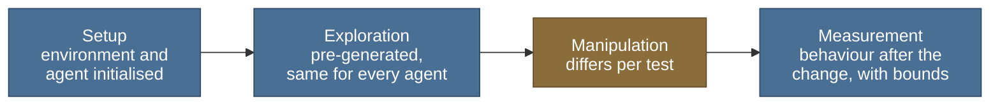

# Test battery

> Public summary. Detail is withheld until submission under the [disclosure policy](disclosure-policy.md).

## Purpose

The battery tests whether an agent's behaviour depends on how places and items relate to one
another, rather than only on responses to its current input that reward has strengthened. Each
of its five tests follows a classic idea from animal learning. In each one, something changes
after the agent has learned: a goal appears, a route closes, a direct route becomes possible,
the observations change, or a question is asked about a pair never presented together. A
stimulus-response mapping memorised during learning is not the most direct account of good
behaviour after the change; knowledge of the structure of the environment is.

The paradigms are borrowed as behavioural tests, and they are published. How each is
operationalised for an agent, and its pass criterion, are the project's own and are pre-registered
privately; they are not a published protocol for artificial agents. A result on a test is evidence
about the agent's behaviour on that test. It is not a statement about how animals solve the task,
and it says nothing about the agent beyond the behaviour measured
([claims-and-scope.md](claims-and-scope.md)).

The battery is model-agnostic. Every agent, the spiking model included, runs through the same
interface, on the same environments, under the same rules.

## The five tests

| Test | Classic paradigm | What it probes |
|---|---|---|
| T1 Latent learning | Rats that explored a maze without reward, and were then given food in it, soon matched rats rewarded from the start (reviewed in Tolman, 1948). | Whether structure acquired during reward-free exploration is available as soon as a goal is introduced. |
| T2 Detour | Rats that knew several routes to food met a block on the shortest route at a point it shared with the next one; most then chose the route that avoided the block (Tolman and Honzik, 1930). | Whether a blocked familiar route leads the agent to a suitable alternative, using what it already knows about the environment. |
| T3 Shortcut | Rats trained on an indirect route to a goal, when that route was blocked and a set of new paths was offered, chose the path pointing directly toward the goal's location more often than any other, the other rats spreading over the remaining paths in a chance fashion (Tolman, Ritchie and Kalish, 1946). | Whether the agent takes a direct route between places it knows but has never travelled between directly. |
| T4 Structural transfer | In the tradition of learning sets: monkeys trained on a long series of discrimination problems, each with new objects, came to solve new problems of the same kind almost at once (Harlow, 1949). | Whether structure learned in one environment speeds learning in another that shares its layout but not its observations. |
| T5 Transitive inference | Rats trained only on adjacent pairs of an ordered series (A over B, B over C, and so on) chose correctly between items never presented together, such as B and D (Davis, 1992; Dusek and Eichenbaum, 1997). | Whether relations learned one pair at a time are combined into an order that supports inference about untrained pairs. |

## Common structure

Every test follows the same four steps. What the exploration step presents, what changes in the
manipulation step, and what is measured afterwards differ from test to test.

| Step | What happens |
|---|---|
| Setup | An environment is generated from a recorded seed and the agent is initialised. |
| Exploration | The agent is taken through pre-generated exploration, the same for every agent. In latent learning it carries no reward. In transitive inference it presents only adjacent pairs of the ordered series. |
| Manipulation | One thing changes: a goal is introduced, a route is blocked, a direct route becomes available, the observations are replaced, or untrained pairs are queried. |
| Measurement | The agent's behaviour after the change is recorded and reported alongside the random-agent and oracle bounds. |

## Common rules

- **Shared exploration.** Exploration trajectories are generated in advance and recorded. Every
  agent receives the same ones, so differences in results cannot be traced to differences in
  the exploration data.
- **Equal budget.** Every agent gets the same total budget of interaction with the environments.
- **Separate tuning set.** Hyperparameters are tuned only on a separate development set of
  environments. The test environments are never used for tuning.
- **Bounds in every report.** Every result is reported next to a random agent, as a lower
  bound, and a shortest-path oracle that knows the true layout of each environment, as an upper
  bound.
- **Seeds and intervals.** Every test runs with at least five seeds, and results carry bootstrap
  95% confidence intervals. The statistical methods are described in
  [engineering.md](engineering.md).
- **Pre-registered criteria.** The pass criterion of every test is written down before any run.
  A salted hash of that record is committed publicly, so the date it was fixed can be checked.
  Its content stays private until submission, when the frozen file is published unchanged and
  anyone can recompute its hash. The commitments are listed in the
  [disclosure policy](disclosure-policy.md) and recorded in
  [`tools/research_plan.json`](../../tools/research_plan.json).

## Environment families

Three families, each deterministic and generated from recorded seeds:

- **Grid worlds with repeating observations.** The same observation can occur at more than one
  location, so the current observation alone does not identify where the agent is.
- **Growing mazes.** The same kind of environment at increasing size, used for scaling curves.
- **Abstract relational structures.** Items linked by relations rather than by space, such as
  ordered chains.

## Comparator families

Every comparator runs on the same environments, from the same exploration data, with the same
interaction budget.

| Comparator | Role |
|---|---|
| Random agent | Lower bound in every report. |
| Shortest-path oracle | Upper bound in every report. It knows the true layout of each environment. |
| Model-free reinforcement learning | Whether a policy learned from reward alone accounts for the behaviour. |
| Recurrent model-free agents | Whether memory of recent experience is enough. |
| A small transformer agent | Whether a general-purpose sequence model trained on the same experience is enough. |
| The successor representation (Dayan, 1993) | A reference that learns the expected future occupancy of states, between model-free and model-based learning. |
| Published cognitive-map models | Reference models from the cognitive-map literature, each checked against the behaviour its own paper reports before it is used. They are not named on this page. |

### Fairness checklist

Every item holds before a comparison is reported.

| Check | What it guards against |
|---|---|
| The same exploration data for every agent | One agent seeing more informative experience |
| The same interaction budget for every agent | One agent learning from more experience |
| An equal hyperparameter-search budget, recorded per agent | One agent being tuned harder than another |
| Development and test environments kept apart | Tuning that fits the test environments |
| At least five seeds per agent and test | A result that holds for a single run only |
| At least one test that suits each comparator's strengths | A comparator set up to fail |

## What is withheld until release

This page stays at the level of the classic sources. The following are not on it. They do not
all become public at the same time, and some are not released through the
[disclosure policy](disclosure-policy.md) at all.

| Material | When it becomes public |
|---|---|
| The success definition and pass criterion of each test, committed by hash before any run | At paper submission, when the frozen file is published unchanged and its hash can be checked |
| The operational protocol of each test, including its lengths, trial structure and measurements; environment sizes, variants and data format | With the battery code release, which comes after paper submission at the earliest |
| The experiment plan and the order of runs; the expected result of each comparator on each test; the results of runs | Withheld under the disclosure policy. They are not part of the battery release. |

## References

Three works cited on this page are not in the [reading list](reading-list.md), which holds the
other citations. They are listed here. Each DOI was checked against its Crossref record; the
1930 report has no DOI.

- Davis, H. (1992). Transitive inference in rats (*Rattus norvegicus*). *Journal of
  Comparative Psychology*, 106(4), 342-349.
  [doi:10.1037/0735-7036.106.4.342](https://doi.org/10.1037/0735-7036.106.4.342)
- Harlow, H. F. (1949). The formation of learning sets. *Psychological Review*, 56(1), 51-65.
  [doi:10.1037/h0062474](https://doi.org/10.1037/h0062474)
- Tolman, E. C., and Honzik, C. H. (1930). "Insight" in rats. *Univ. Calif. Publ. Psychol.*,
  4, 215-232. This is the detour study, not the latent-learning report the same authors
  published that year.

## Related pages

- [Overview](README.md)
- [Roadmap](roadmap.md) and [gates](gates.md): the environments, the battery and the
  comparators are built in phase P1, which closes at gate B.
- [Claims and scope](claims-and-scope.md)
- [Reading list](reading-list.md)
