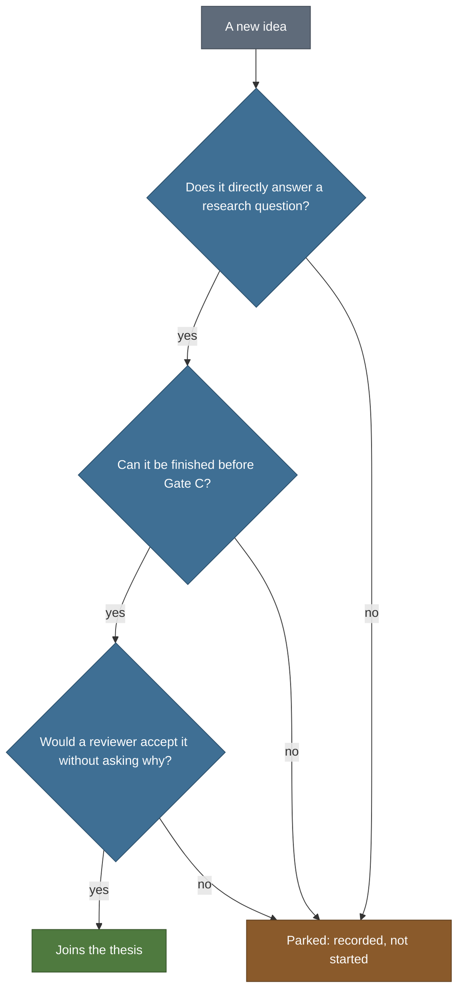

# Claims and scope

> Public summary. Detail is withheld until submission under the [disclosure policy](disclosure-policy.md).

This page sets what the thesis may say about its model, what the thesis covers, and how a new
idea is kept out of it. The rules govern every public sentence about the thesis: these pages, the
thesis text, the paper and any talk. They extend the claims rule that Psyche already follows
(rule 1 in [CLAUDE.md](../../CLAUDE.md)).

## The core rule

In this thesis, "cognition" names a class of behaviour that a test can measure. It is never a
claim about inner states.

A sentence that uses a cognitive word must be rewritable as a statement about what an agent did
in a defined test, with a captured result behind it. If it cannot be rewritten that way, it is
not written.

## The ceiling on claims

The strongest statement the thesis may make about its model is fixed in shape, not in content: it
names the behaviours of the [test battery](test-battery.md) that the model showed, each backed by a
captured result, and reports their cost as an analytic estimate of synaptic operations beside the
same estimate for the comparators. A behaviour that was not shown is left out rather than softened.
A cost comparison is stated in whichever direction the captured result gives, and only under the
[energy claims](#energy-claims) rules below.

## Never

Each line below applies to every public text about the thesis.

- Never: say the model "understands" or "thinks", or use "consciousness" about it.
- Never: call it a mind, sentient, aware, an AGI or a validated cognitive model.
- Never: "the brain does it this way". Say "brain-inspired" or "biologically plausible".
- Never: a general claim that spiking networks are more efficient than conventional networks.
- Never: a priority claim, such as "the first" or "first model to", unless [Gate A](gates.md)
  has checked it and an entry in [DECISIONS.md](../../DECISIONS.md) records that.
- Never: energy presented as measured. It is an analytic estimate or a lower bound.
- Never: a number without a captured source, meaning a results file produced by code.
- Never: a planned result written as if it had been obtained.

Efficiency is stated only in the narrow form "on this task, with this measure, under these
assumptions". The thesis phrases on this list are also kept as data in
[`tools/ledger.json`](../../tools/ledger.json) under `thesis_forbidden_claim_terms`, and
Psyche's own under `forbidden_claim_terms`, so that tooling can check public text against them.

## Scope

### In scope

| Area | What the thesis covers |
|---|---|
| Environments | The three families of the [test battery](test-battery.md#environment-families): grid worlds with repeating observations, where the current observation alone does not identify the location; growing mazes; and abstract relational structures, such as an ordered chain. |
| Tests | The five classic paradigms of the [test battery](test-battery.md): latent learning, detour, shortcut, structural transfer and transitive inference. |
| Comparisons | The [comparator families](test-battery.md#comparator-families) of the test battery: model-free reinforcement learning, recurrent model-free agents, a small transformer agent, the successor representation and published cognitive-map models. |
| Repetition | At least five seeds per model and test, with bootstrap confidence intervals (see the [test battery](test-battery.md#common-rules)). |
| Cost | An analytic estimate of synaptic operations, under the energy rules below. |

### Out of scope

- Measurement on neuromorphic hardware. Energy is estimated analytically instead.
- Three-dimensional or visual environments.
- Language tasks.
- Large-scale benchmarks, such as ImageNet or continual-learning image benchmarks.
- Theoretical analysis of new biophysical learning rules.

## The scope-creep test

A new idea joins the thesis only if the answer to all three questions is yes:

1. Does it directly answer one of the research questions (RQ1 to RQ4 in the
   [overview](README.md))?
2. Can it be finished before [Gate C](gates.md)?
3. Would a reviewer accept it without asking why it is there?

If any answer is no, the idea is parked: it is recorded and not started.

## Energy claims

A spiking network simulated on a GPU runs on hardware that does not exploit spikes, so its
energy use says nothing about spiking efficiency. Any energy figure in the thesis is therefore
an estimate of what the computation would cost, never a reading of what it did cost. The
principles:

- **Estimates and lower bounds only, named as such.** Every energy figure is called an analytic
  estimate or an analytic lower bound wherever it appears: in tables, in figures and in prose.
  The limitation is stated in the text before a reviewer has to ask for it.
- **Hardware readings are never evidence.** GPU wall-clock time and watt readings are never
  presented as evidence of energy efficiency.
- **No borrowed hardware figures.** The estimates are not set against energy figures reported
  for neuromorphic chips.
- **No general efficiency claim.** Whether spiking networks save energy depends on the
  hardware, on how sparse their activity is and on what is counted, memory access included.
  [Dampfhoffer et al. (2023)](reading-list.md#energy-accounting) show this with a
  hardware-aware analysis, and it is the reason the thesis makes no general claim. Efficiency
  is stated only for this task, this measure and these assumptions.
- **Like for like.** Every model is estimated under the same assumptions, so a comparison
  reflects the models and not the accounting.
- **Sensitivity analysis is mandatory.** The estimate rests on assumptions about the cost of
  each operation and about what is counted, so every energy result is reported across a
  sensitivity analysis of those assumptions.
- **A ranking must survive every setting.** A ranking, including any cost comparison in the
  statement above, is stated only if it holds in every setting of the sensitivity analysis.
  Otherwise the text says the comparison depends on assumptions.
- **The counter is checked before it is trusted.** The operation counter is tested and checked
  against an established reference count before its numbers are used.

The formula, the counted quantities, the cost constants and the sensitivity settings are part of
the withheld method.

## Writing rules

| Rule | In practice |
|---|---|
| Paragraph shape | A claim, then its evidence (a figure, a table or a citation), then a limitation or a transition. |
| Sentences | Short and active. "X does Y (Fig. N)" rather than "we show that". |
| Terms | One name for one thing, used the same way everywhere. A second name for the same thing is a defect. |
| Numbers | Mean with a confidence interval. A value rather than "approximately". "Significant" only with a statistical test behind it. |
| Restraint | "Novel" only with evidence. No priority claim unless Gate A has checked it and DECISIONS.md records it, no marketing language, no exclamation marks. |
| Figures | Every axis labelled with its unit, a colour-blind-safe palette, and every figure cited in the text. Figures are generated from code. |
| Citations | Primary sources, with a DOI, and the year and venue checked. A reference recalled by a language model is not used until it has been checked against the primary source. |
| Status words | Lowercase in thesis prose, exactly the vocabulary of `tools/thesis_plan.json`: planned, active and done for phases; upcoming and decided for gates; upcoming, met and missed for deadlines. |
| Drafting | Skeleton, then a few points per section, then prose, then alignment with the figures, then a cut. |

The thesis text follows the same rules as the paper.
