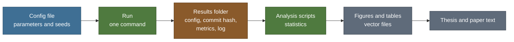

# Engineering standards

> Public summary. Detail is withheld until submission under the [disclosure policy](disclosure-policy.md).

These standards govern the thesis code and the analysis behind every number the thesis reports.
They describe how the work is done. They make no claim about its results.

The thesis code reaches this repository only by export, under `thesis/`, with its own pinned
dependencies ([D-031](../../DECISIONS.md)). It is not released yet; the standards govern it as
it is written, and every export carries them. Psyche, which is paused, keeps its own
conventions, described in its [methodology](../METHODOLOGY.md). Where the two meet, the section
on the [two runners](#two-runners) says how they are kept apart.

## Code

- **English** for names, comments and docstrings. Docstrings are short and say what a function
  does and why.
- **Small functions.** The environments and the metrics are pure functions without side effects,
  and each has unit tests; the battery has unit tests too.
- **Model-independent evaluation.** The environments, the battery and the metrics do not depend
  on any model. Every agent is driven through one common interface, so all agents are measured
  by the same code.
- **Type hints** throughout. Code is clean under `ruff` and formatted with `black` before it is
  committed.
- **No magic numbers.** Every parameter, size and seed lives in a config file, and the code reads
  it from there.
- **Formulas cite their source.** Where code implements an equation, its docstring states the
  equation and the source it comes from.
- **Logging, not print.** Output goes through Python's `logging` module, with the level set in
  config. Counters collected during a run are written to file with the run's other outputs.
- **Scripts produce results.** Notebooks are for exploration only. Anything that becomes a result
  is moved into a script.
- **Correct before fast.** Code is optimised only after a correctness test covers it.

## Commits and branches

- **Message form:** `type(scope): summary`, for example `feat(battery): add the detour test`.
  Types are `feat`, `fix`, `test`, `docs` and `exp` (experiment scripts and configs). The scope
  names the part of the work a commit touches, for example `envs`, `battery`, `metrics` or
  `figures`. These types apply to the thesis package's own history.
- **`main` always works.** Work happens on separate branches, and the test suite passes before a
  branch is merged.
- **No private identifiers.** Commit messages, branch names and pull requests in this repository
  never carry an identifier that exists only in the private companion.
- **This repository's prefixes.** Thesis and program work in this repository uses the prefixes
  set out in [CLAUDE.md](../../CLAUDE.md): `docs(thesis)`, `chore(program)`, `chore(release)`
  and `chore(publish)`. Psyche's commits keep their own brick-scoped convention, set out there
  too.

## Determinism tiers

Not every computation can be made bit-exact. The thesis therefore uses three tiers, and **each
reported result states its tier.** A result built from parts at different tiers states the
weakest of them.

| Tier | Guarantee | Applies to | How it is checked |
|---|---|---|---|
| A | Bit-exact across CPython versions and hash seeds | Environments, battery, metrics, counters | Outputs from fresh interpreter processes, under each supported CPython version and several hash seeds, compared byte for byte, as described below |
| B | Bit-exact on CPU for one pinned version, with deterministic algorithms enabled in the deep-learning framework | CPU runs | Deterministic algorithms are enabled where the framework provides them; where it does not, this is documented and the result does not claim tier B |
| C | Statistical reproducibility | GPU runs | Fixed seeds; results reported with confidence intervals over seeds |

Two lessons carry over from Psyche's record, described in its [methodology](../METHODOLOGY.md):

- **Fresh processes.** A determinism check runs in separate interpreter processes, because a
  single process fixes its hash seed and hides order dependence that varies between processes.
- **Exact comparison.** Outputs are compared exactly. A comparison after rounding cannot see a
  difference in the last bit of a float, which is where such defects show up.

Determinism is established by removing order dependence from the code, not by sweeping seeds
alone.

## Seeds

Python's `random` module, NumPy, the deep-learning framework (CPU and GPU) and environment
generation each get their own seed. One seeding utility sets them all, and the run's config
records them.

Environment instances and exploration trajectories are generated once, fixed and stored. Every
agent uses the same ones, so every agent receives the same exploration data.

## Runs and reproduction

- **Every run records itself.** A run writes its full config and the git commit hash it ran from
  next to its results. The config's hash goes into the run record.
- **Pinned dependencies.** Versions are pinned in the package's `pyproject.toml`, and a lock file
  records the exact installed versions.
- **One command per result.** A single command regenerates the environments, runs the agents,
  analyses the output and draws the figures for a result.
- **No hand-typed numbers.** Tables and figures are produced by scripts from results files.
- **With a submission:** an anonymous copy of the code, with a README that gives the full
  commands, expected run times and the hardware they were measured on.

## Data and results

- **Outside git.** The thesis package's `data/` and `results/` folders are git-ignored and never
  committed.
- **One folder per run.** Each results folder holds the run's config, seeds, commit hash, metrics
  file and log.
- **Archived, never deleted.** A superseded result is moved to an archive, not removed.
- **Negative results are kept.** A result that does not support the thesis is recorded and
  reported in an appendix.

## Statistics

- **Confidence intervals.** Uncertainty is reported as a bootstrap 95% confidence interval over
  seeds, with 10,000 resamples.
- **Comparisons between models.** Differences between models are tested with permutation tests,
  with Holm correction across multiple comparisons.
- **Reference bounds.** Every behavioural figure shows a random agent and an oracle, so each
  result can be read against a floor and a ceiling.

## Figures

- **Generated from code.** Every figure is drawn by a script and never edited by hand.
- **Vector files.** Figures are written as PDF or SVG.
- **Colourblind-safe palette** in every figure.
- **Traceable numbers.** Every number in the text, a table or a figure traces to a results file.

## Two runners

This repository holds two codebases with different test runners. They are kept apart on
purpose.

| | Psyche | Thesis package |
|---|---|---|
| Runner | [`run_tests.py`](../../run_tests.py) | `pytest`, run inside `thesis/` |
| Dependencies | Python standard library only | Its own pinned dependencies |
| Tests live in | `tests/` and `experiments/` | Inside `thesis/` |

- **Psyche's suites are never run under pytest.** They use a small built-in harness that counts
  explicit checks. Under pytest a failed logical check would not raise, so pytest could report a
  pass on a real failure. They are run as scripts, through `python3 run_tests.py`.
- **No pytest configuration at the repository root.** A root-level pytest run would collect
  Psyche's suites. The thesis package keeps its pytest configuration inside `thesis/`.
- **No crossing.** Nothing under `thesis/` is registered in `run_tests.py`, no thesis test is
  placed in the root `tests/` or `experiments/` folders, and `src/` never imports from
  `thesis/`.

## Not on this page

Some engineering detail is not published here, or not yet:

- **Experiment configurations** are never released through this repository's release process.
  The [release groups](disclosure-policy.md#release-groups) in the disclosure policy list them
  with the other material that process never releases.
- **Pinned dependencies** become public with the package's earliest released group, in its own
  project file (see the [thesis package README](../../thesis/README.md)).
- **Run times**, and the hardware they were measured on, are given in the anonymous copy that
  accompanies a submission.

Material reaches this repository only as complete, working, older versions, never the current
state of the work.
