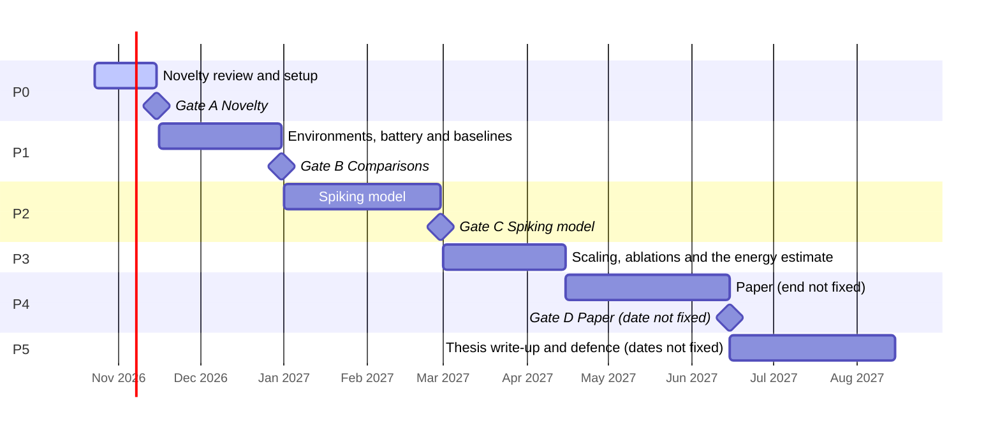
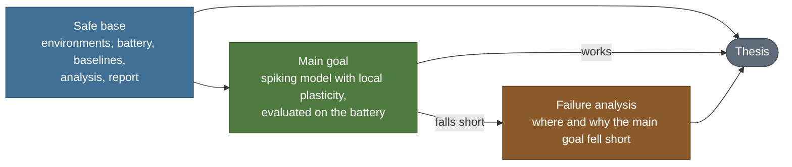

# Roadmap

> Public summary. Detail is withheld until submission under the [disclosure policy](disclosure-policy.md).

This page shows the thesis plan at public granularity: its phases, the layers that keep the
thesis standing if the main goal falls short, and the paper submission deadline. What each
decision gate asks, and what happens if it is not passed, is on [Decision gates](gates.md). The
thesis itself is introduced in the [overview](README.md).

## Phases

The work runs in phases, and most close at a decision gate. Each phase's outputs are listed in
the [plan file](../../tools/thesis_plan.json). Where a phase or gate date depends on a date that
is not yet known, such as the submission deadline or the university calendar, the plan records
the rule that will fix it instead of a date.

<!-- generated:phases-table:start -->
| Phase | Title | Start | End | Gate | Status |
|---|---|---|---|---|---|
| P0 | Novelty review and setup | 2026-10-23 | 2026-11-15 | A | active |
| P1 | Environments, battery and baselines | 2026-11-16 | 2026-12-31 | B | planned |
| P2 | Spiking model | 2027-01-01 | 2027-02-28 | C | planned |
| P3 | Scaling, ablations and the energy estimate | 2027-03-01 | 2027-04-15 | — | planned |
| P4 | Paper | 2027-04-15 | the submission deadline (not yet announced) | D | planned |
| P5 | Thesis write-up and defence | after submission | the university calendar (not yet confirmed) | — | planned |
<!-- generated:phases-table:end -->

The chart draws the same plan on a calendar. A phase or gate whose date is not fixed is drawn
out to a placeholder and labelled "not fixed". Its position on the chart is not a date. A
deadline appears on the chart only once its date is fixed; until then it is listed only under
[Deadlines](#deadlines).

<!-- generated:plan-gantt:start -->

<!-- generated:plan-gantt:end -->

## Layers

The plan is layered so that the thesis does not rest on its riskiest part.

<!-- generated:layers-table:start -->
| Layer | Title | Summary |
|---|---|---|
| L1 | Safe base | Environments, the battery, baseline comparisons, analysis and the report. The thesis stands on this even if the spiking model does not work. |
| L2 | Main goal | The spiking model with local plasticity, evaluated on the battery, with an analytic estimate of its synaptic operations. |
| L3 | Failure analysis | If the main goal falls short, a documented account of where and why, kept as a result in its own right. |
<!-- generated:layers-table:end -->

The safe base exists so that the thesis stands even if the spiking model does not work. The
environments, the [test battery](test-battery.md), the baseline comparisons, the analysis and
the report are a complete piece of work on their own, and the plan completes the safe base
before work on the spiking model begins. The main goal builds on that base rather than replacing
it. If the main goal falls short, the failure analysis records where and why, and that account
is kept as a result in its own right.

## Deadlines

<!-- generated:deadlines-table:start -->
| Deadline | Due | Status |
|---|---|---|
| Paper submission to a major peer-reviewed ML venue | not set; estimate: spring 2027 (unconfirmed) | upcoming |
<!-- generated:deadlines-table:end -->

The paper is planned for submission to a major peer-reviewed ML venue (2027). Its deadline has
not been announced. Until it is, the plan carries an estimate marked unconfirmed. The end of the
paper phase and the Paper gate depend on that deadline, so the plan states them as rules relative
to it rather than as dates.

## How dates change

- **One source.** [`tools/thesis_plan.json`](../../tools/thesis_plan.json) is the only source of
  thesis dates: phases, gates and deadlines. The plan tables and the timeline chart on this page
  are rendered from it, as are the plan blocks in the other documents that show the plan. The
  layers diagram is drawn by hand and carries no dates.
- **Rendered, not typed.** The plan tables and the chart are written by
  `python3 tools/publish/render_plan.py --write` and are never edited by hand. To change a date,
  change the plan and render again.
- **Moves are recorded.** Each dated gate keeps its originally planned date as `baseline_date`
  next to its current `date`. A gate set by a rule records its date when the rule resolves, and
  that change also gets a changelog entry. A gate date that moves away from its baseline needs an
  entry in the plan's `changelog`, which records the item and field that changed, the old and new
  value, the date of the change and the reason. The plan's validator rejects a moved gate date
  that has no such entry. The change log is part of the public plan file.
- **Fixed status words.** A phase is planned, active or done; a gate is upcoming or decided; a
  deadline is upcoming, met or missed. A decided gate does not show its verdict until submission
  (see [Decision gates](gates.md)).

## Not on this page

These stay in a private companion until submission, under the
[disclosure policy](disclosure-policy.md):

- the weekly milestones;
- the experiment plan and the order in which the experiments run;
- the criteria behind each gate.

Material reaches this repository only as complete, working, older versions, never the current
state of the work.
